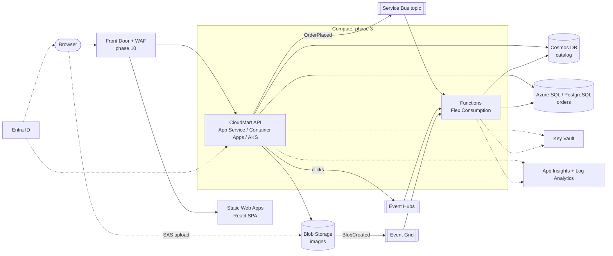

# CloudMart: a hands-on lab for AZ-305

A small e-commerce ordering platform (.NET 10 + React) built to be deployed to Azure **one learning phase at a time**.
It runs fully in memory on a laptop on day one. Each phase turns on a real Azure service with a switch in
[`infra/main.bicepparam`](infra/main.bicepparam), and the app's **Platform** page shows what changed.

- **[docs/learning-path.md](docs/learning-path.md)**: 15 phases of labs: build it, see it, break it, plus the
  architect's decision tables the exam tests.
- **[docs/az305-gap-analysis.md](docs/az305-gap-analysis.md)**: your 10 phases against the official AZ-305 outline
  (April 2026), and what was added.

## Why an online shop

Each part of a shop needs a different Azure design decision:

| Business capability | Azure design | Concept it teaches |
|---|---|---|
| Product catalog | Cosmos DB, partitioned by category | Semi-structured data, partition keys, RU cost |
| Orders | Azure SQL (or PostgreSQL), EF Core | Relational data, transactions, Entra-only DB auth |
| Checkout | API returns **202** → Service Bus topic → Functions | Async processing, retries, DLQ, idempotency, filtered pub/sub |
| Product images | Browser → Blob (SAS) → Event Grid → Function | Valet-key pattern, event-driven processing |
| "Trending" | Browser → API → Event Hubs → Function → Cosmos | Streaming ingestion, partitions, consumer groups |
| Payment gateway key | Key Vault (config provider *and* app-setting reference) | Secret management; **zero keys anywhere else** |
| Everything | Managed identities + data-plane RBAC | Identity-based access instead of connection strings |

## Frontend: React (recommended) or Angular?

**React + TypeScript + Vite**, which is what's included. For this goal the frontend is a means, not the subject:

- The SPA's only Azure touchpoints are MSAL sign-in, the Application Insights JS SDK, a runtime `config.json`, and a
  direct SAS upload to Blob Storage. All of them are equally available to both frameworks (`@azure/msal-react`,
  `@azure/msal-angular`).
- React + Vite has the least framework ceremony, builds in under a second, and deploys to Static Web Apps with no
  configuration, so more of your time goes to Azure.
- Choose **Angular** if your team already ships Angular. Its DI and HTTP interceptors (`MsalInterceptor`) make
  token handling slightly tidier in large apps. Nothing in the backend, infrastructure or labs would change.

## Architecture



Solid arrows are data flows; dotted ones are identity, secrets and telemetry. Every arrow to a data service
authenticates with a **managed identity**: there are no keys or connection-string secrets.

## Repository

```
src/CloudMart.Core/        domain, services, and each boundary twice: in-memory + Azure (see Abstractions.cs)
src/CloudMart.Api/         ASP.NET Core minimal API, Entra ID auth, OpenTelemetry, health checks, Dockerfile
src/CloudMart.Functions/   Service Bus, Event Grid, Event Hubs and timer triggers (isolated worker)
src/cloudmart-web/         React 19 + TypeScript + Vite SPA (MSAL, App Insights, runtime config.json)
tests/CloudMart.Core.Tests business rules: pricing, stock, payment limit, idempotent redelivery
infra/main.bicep           subscription-scoped entry point; one switch per phase
infra/modules/             24 modules + shared types: network, data, messaging, compute, edge, governance...
pipelines/                 Azure Pipelines: build → what-if/deploy infra → deploy apps
deploy/                    SQL/PostgreSQL identity grants, Kubernetes manifest, Load Balancer lab script
docs/                      learning path, gap analysis, KQL queries
```

## Run it locally (no Azure needed)

```bash
dotnet run --project src/CloudMart.Api
```

```bash
cd src/cloudmart-web && npm install && npm run dev
```

Open http://localhost:5173. Without Entra ID configured, the API signs every caller in as a local admin. It refuses
to start that way outside `Development` unless `Auth__AllowAnonymousDevMode=true`, which the Bicep sets only until
phase 6.

To run locally **against Azure** (after phase 4), copy the `localDevelopmentSettings` deployment output into
`appsettings.Development.json`. `DefaultAzureCredential` uses your `az login`, and the Bicep gives *you* the same data
roles as the app.

## Deploy to Azure

```bash
az login
# fill in deployerPrincipalId / deployerPrincipalName / ownerEmail in infra/main.bicepparam
az deployment sub what-if -l eastus2 -f infra/main.bicep -p infra/main.bicepparam
az deployment sub create  -l eastus2 -f infra/main.bicep -p infra/main.bicepparam
```

Then follow [phase 1](docs/learning-path.md#phase-1--foundations) to push the code, or set up the pipeline in
[phase 8](docs/learning-path.md#phase-8--devops).

| Phase | Switch(es) in `main.bicepparam` | What changes on the Platform page |
|---|---|---|
| 1 Foundations | (defaults) | Hosting: **App Service**, your region |
| 2 Networking | `deployNetwork`, `deployJumpbox` | Integration is outbound via VNet; jumpbox + Bastion |
| 3 Compute | `deployContainerApps`, `deployAks`, `deployAcr` | Hosting: **Container Apps** / **Kubernetes** |
| 4 Data | `deployCosmos`, `deploySql`, `deployPostgres`, then `enablePrivateEndpoints` | Catalog **Cosmos DB**, orders **Azure SQL** |
| 5 Messaging | `deployMessaging`, then `deployEventGridSubscription` | Order events **Service Bus**, click stream **Event Hubs** |
| 6 Security | `enableEntraAuth` + app registration ids | Auth **Entra ID**; Admin tab requires the app role |
| 7 Observability | `deployGrafana` | Alerts fire on chaos; Grafana dashboards |
| 8 DevOps | `deployAcr` (+ pipeline) | Version = pipeline build id |
| 9 Governance | `deployGovernance` (on by default) | Policies + budget on the resource group |
| 10 Architecture | `deployFrontDoor`, `deployAppGateway`, `secondaryApiHostName` | Front Door lock ✓; region flips on failover |
| 11 Continuity | `storageSku`, `cosmosSecondaryLocation` | Multi-region data |
| 12 Integration | `deployAppConfig`, `deployRedis`, `deployApim` | Feature flags, Redis L2 cache |

## Cost guard rails

- Defaults deploy only cheap or free tiers: B1 App Service, Flex Consumption, Static Web Apps Free, Cosmos DB free
  tier, serverless SQL that auto-pauses, Log Analytics with a 1 GB/day cap, and a **budget alert** at 50% / 80% /
  forecast 100% of `monthlyBudget`.
- Expensive switches (AKS, Application Gateway, Grafana, Front Door Premium, Bastion Basic) are off by default and
  flagged in the learning path. Turn them on, learn, turn them off.
- `false` does not delete anything with `az deployment sub create`. Use a **deployment stack** (phase 8) so removed
  switches delete their resources, or delete the resource group:
  `az group delete -n rg-cloudmart-dev --yes`.
- Key Vault is soft-deleted for 7 days. To redeploy with the same name right away:
  `az keyvault purge -n <keyVaultName>`.

## Status

All .NET projects build, the 8 unit tests pass, the SPA type-checks and builds, and every Bicep file compiles with
zero warnings (Bicep 0.48). Nothing has been deployed to a real subscription from this repository yet, so treat the
first deployment of each phase as part of the lab. `what-if` first, and read the error messages: they are usually
exactly what the exam asks about.
