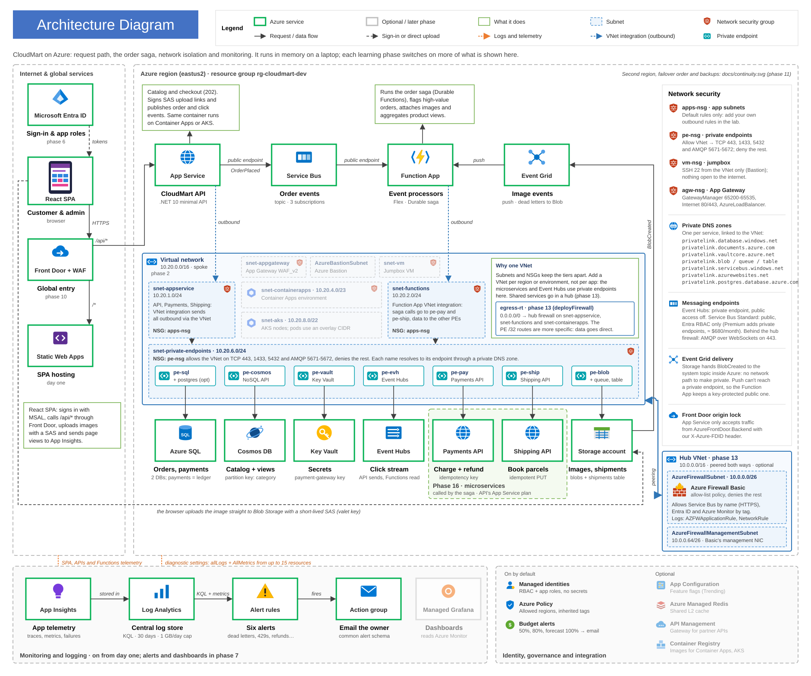
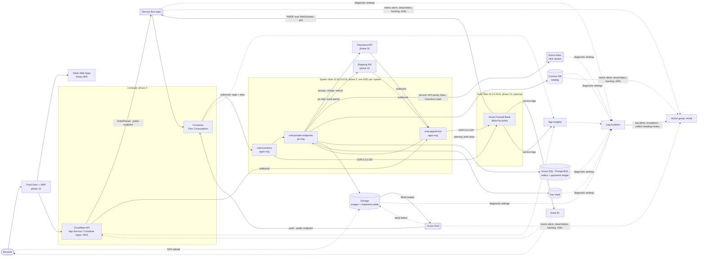

# CloudMart: a hands-on lab for AZ-305

A small e-commerce ordering platform (.NET 10 + React) built to be deployed to Azure **one learning phase at a time**.
It runs fully in memory on a laptop on day one. Each phase turns on a real Azure service with a switch in
[`infra/main.bicepparam`](infra/main.bicepparam), and the app's **Platform** page shows what changed.

- **[docs/learning-path.md](docs/learning-path.md)**: 16 phases of labs: build it, see it, break it, plus the
  architect's decision tables the exam tests.
- **[docs/az305-gap-analysis.md](docs/az305-gap-analysis.md)**: your 10 phases against the official AZ-305 outline
  (April 2026), and what was added.
- **[docs/portal-guide.pdf](docs/portal-guide.pdf)**: new to Azure? A beginner's guide that builds phase 1 by clicking
  in the Azure Portal, then maps every click to the CLI and the Bicep. Its source is
  [docs/portal-guide.html](docs/portal-guide.html).
- **[docs/AZURE_DEVELOPMENT_GUIDE.md](docs/AZURE_DEVELOPMENT_GUIDE.md)**: how the code works with Azure, for
  beginners. Every Azure class, setting and permission, how the services connect, request flows with diagrams, and
  troubleshooting.

## Why an online shop

Each part of a shop needs a different Azure design decision:

| Business capability | Azure design | Concept it teaches |
|---|---|---|
| Product catalog | Cosmos DB, partitioned by category | Semi-structured data, partition keys, RU cost |
| Orders | Azure SQL (or PostgreSQL), EF Core | Relational data, transactions, Entra-only DB auth |
| Checkout | API returns **202** → Service Bus topic → Functions | Async processing, retries, DLQ, idempotency, filtered pub/sub |
| Product images | Browser → Blob (SAS) → Event Grid → Function | Valet-key pattern, event-driven processing |
| "Trending" | Browser → API → Event Hubs → Function → Cosmos | Streaming ingestion, partitions, consumer groups |
| Payment gateway key | Key Vault (config provider *and* app-setting reference) | Secret management; **zero keys anywhere else** |
| Payments (phase 16) | Payments API → Azure SQL **ledger** table, private endpoint | Database per service, idempotency keys, tamper-evident data |
| Shipping (phase 16) | Shipping API → **Table Storage**, private endpoint | Key-value storage, idempotent PUT |
| Charge, ship, refund on failure | **Durable Functions** saga | Orchestration, compensating transactions, app-role auth between services |
| Everything | Managed identities + data-plane RBAC | Identity-based access instead of connection strings |

## Frontend: React (recommended) or Angular?

**React + TypeScript + Vite**, which is what's included. For this goal the frontend is a means, not the subject:

- The SPA's only Azure touchpoints are MSAL sign-in, the Application Insights JS SDK, a runtime `config.json`, and a
  direct SAS upload to Blob Storage. All of them are equally available to both frameworks (`@azure/msal-react`,
  `@azure/msal-angular`).
- React + Vite has the least framework ceremony, builds in under a second, and deploys to Static Web Apps with no
  configuration, so more of your time goes to Azure.
- Choose **Angular** if your team already ships Angular. Its DI and HTTP interceptors (`MsalInterceptor`) make
  token handling slightly tidier in large apps. Nothing in the backend, infrastructure or labs would change.

## Architecture



Every arrow to a data or messaging service authenticates with a **managed identity**: there are no keys or
connection-string secrets. From phase 2, the API and Functions send their outbound traffic through VNet-integrated
subnets, and the data stores and Event Hubs are reachable only through **private endpoints**. Service Bus Standard
can't have one, so it stays public but accepts only Entra ID (Premium is the tier with private endpoints). Each subnet
has its own **NSG**, and
every service sends its logs to one **Log Analytics** workspace through diagnostic settings. In phase 16 a **Durable
Functions saga** takes over checkout: it charges through the **Payments API**, books through the **Shipping API**, and
refunds if shipping fails. Both APIs share the App Service plan and are reachable only through private endpoints. In
phase 13 an optional **hub VNet** with **Azure Firewall** is peered to this one, and a route table sends the app
subnets' internet-bound traffic through it: only what the apps call, such as Service Bus, Entra ID and Azure Monitor,
is allowed out. For slides or documents, use the 2× PNG: [docs/architecture.png](docs/architecture.png).

**Identity and access** has its own diagram too, [docs/identity.svg](docs/identity.svg) ([PNG](docs/identity.png)).
It shows how people, services, AKS and the pipeline get Entra ID tokens. Its matrix lists every Azure RBAC role,
Cosmos DB data role, SQL database user and app role that each identity holds (phase 6).

**Disaster recovery** has its own diagram, [docs/continuity.svg](docs/continuity.svg)
([PNG](docs/continuity.png)). It shows what each service fails over to in a second region and what that copy costs.
It also covers what isn't protected, the failover order, and the zones and backups inside each region (phase 11).

**Deployment and operations** are in [docs/operations.svg](docs/operations.svg) ([PNG](docs/operations.png)): the
pipeline, environments, secrets, schema delivery and rollback (phases 8 and 9).

<details>
<summary>Text version (Mermaid, editable)</summary>



Solid arrows are data flows; dotted ones are identity and telemetry.

</details>

## Repository

```
CloudMart.slnx                 the solution: every .NET project in src/ and tests/
src/CloudMart.Core/            domain, services, the order saga, and each boundary twice: in-memory + Azure
src/CloudMart.Api/             ASP.NET Core minimal API, Entra ID auth, OpenTelemetry, health checks, Dockerfile
src/CloudMart.Functions/       Service Bus, Event Grid, Event Hubs, timer triggers + Durable Functions saga
src/CloudMart.Payments/        Payments API (phase 16): idempotency keys, Azure SQL ledger table
src/CloudMart.Shipping/        Shipping API (phase 16): idempotent PUT, Table Storage
src/CloudMart.ServiceDefaults/ what every web service shares: telemetry, health, caller auth, chaos switch
src/cloudmart-web/             React 19 + TypeScript + Vite SPA (MSAL, App Insights, runtime config.json)
tests/CloudMart.Core.Tests     business rules, saga failure paths, payment and shipping idempotency
infra/main.bicep               subscription-scoped entry point; one switch per phase
infra/modules/                 27 modules + shared types: network, hub firewall, data, messaging, compute, edge...
pipelines/                     Azure Pipelines: build → what-if/deploy infra → deploy apps
deploy/                        SQL/PostgreSQL identity grants, Entra app roles, Kubernetes manifest, LB lab script
docs/                          learning path, portal guide, gap analysis, KQL queries
```

The solution file is in the repository root, not in `src/`. It ends in `.slnx`, the XML solution format, rather than
`.sln`. Open it in Visual Studio 2026 or Rider, or build it with `dotnet build CloudMart.slnx`.

## Run it locally (no Azure needed)

```bash
dotnet run --project src/CloudMart.Api
```

```bash
cd src/cloudmart-web && npm install && npm run dev
```

Open http://localhost:5173. Without Entra ID configured, the API signs every caller in as a local admin. It refuses
to start that way outside `Development` unless `Auth__AllowAnonymousDevMode=true`, which the Bicep sets only until
phase 6.

Payments and shipping run inside the API until you start them as services. Run
`dotnet run --project src/CloudMart.Payments` (port 5081) and `src/CloudMart.Shipping` (port 5082), then start the
API with `Payments__BaseUrl=http://localhost:5081` and `Shipping__BaseUrl=http://localhost:5082`. See
[phase 16](docs/learning-path.md#phase-16--microservices-payments-shipping-and-a-saga).

To run locally **against Azure** (after phase 4), copy the `localDevelopmentSettings` deployment output into
`appsettings.Development.json`. `DefaultAzureCredential` uses your `az login`, and the Bicep gives *you* the same data
roles as the app.

## Deploy to Azure

New to Azure? Try [docs/portal-guide.pdf](docs/portal-guide.pdf) first. It builds the same phase 1 resources by
clicking in the portal, in a separate `rg-cloudmart-lab` resource group, so it never fights this deployment.

```bash
az login
# fill in deployerPrincipalId / deployerPrincipalName / ownerEmail in infra/main.bicepparam
az deployment sub what-if -l eastus2 -f infra/main.bicep -p infra/main.bicepparam
az deployment sub create  -l eastus2 -f infra/main.bicep -p infra/main.bicepparam
```

Then follow [phase 1](docs/learning-path.md#phase-1--foundations) to push the code, or set up the pipeline in
[phase 8](docs/learning-path.md#phase-8--devops).

| Phase | Switch(es) in `main.bicepparam` | What changes on the Platform page |
|---|---|---|
| 1 Foundations | (defaults) | Hosting: **App Service**, your region |
| 2 Networking | `deployNetwork`, `deployJumpbox` | Integration is outbound via VNet; jumpbox + Bastion |
| 3 Compute | `deployContainerApps`, `deployAks`, `deployAcr` | Hosting: **Container Apps** / **Kubernetes** |
| 4 Data | `deployCosmos`, `deploySql`, `deployPostgres`, then `enablePrivateEndpoints` | Catalog **Cosmos DB**, orders **Azure SQL** |
| 5 Messaging | `deployMessaging`, then `deployEventGridSubscription` | Order events **Service Bus**, click stream **Event Hubs** |
| 6 Security | `enableEntraAuth` + app registration ids | Auth **Entra ID**; Admin tab requires the app role |
| 7 Observability | `deployGrafana` | Alerts fire on chaos; Grafana dashboards |
| 8 DevOps | `deployAcr` (+ pipeline) | Version = pipeline build id |
| 9 Governance | `deployGovernance` (on by default) | Policies + budget on the resource group |
| 10 Architecture | `deployFrontDoor`, `deployAppGateway`, `secondaryApiHostName`, `lockStaticWebAppToFrontDoor` | Front Door lock ✓; region flips on failover |
| 11 Continuity | `storageSku`, `cosmosSecondaryLocation`, `sqlBackupRedundancy`, `sqlSecondaryLocation`, `eventHubsSecondaryLocation`, `zoneRedundant` | Multi-region data; orders survive a SQL failover |
| 12 Integration | `deployAppConfig`, `deployRedis`, `deployApim` | Feature flags, Redis L2 cache |
| 13 Hub-and-spoke | `deployFirewall` (needs `enablePrivateEndpoints`; **≈ $290/month**), `adminIpAddresses` | Order events **Service Bus (WebSockets)**; egress through Azure Firewall |
| 16 Microservices | `deployPayments`, `deployShipping` (+ app registrations) | Payments **Payments API**, Shipping **Shipping API** |

## Cost guard rails

- Defaults deploy only cheap or free tiers: B1 App Service, Flex Consumption, Static Web Apps Free, Cosmos DB free
  tier, serverless SQL that auto-pauses, Log Analytics with a 1 GB/day cap, and a **budget alert** at 50% / 80% /
  forecast 100% of `monthlyBudget`.
- Expensive switches (AKS, Application Gateway, Grafana, Front Door Premium, Bastion Basic, Azure Firewall, the SQL
  failover group, zone redundancy) are off by default and flagged in the learning path. Turn them on, learn, turn them
  off. The SQL failover group is the one people forget: geo-replicated serverless databases never auto-pause, so it
  costs about $750/month while it exists.
- `deployFirewall` is one of the most expensive switches: Azure Firewall Basic is **≈ $290/month plus about $0.065
  per GB**, billed every hour it exists. It is off by default. Deploy it, do the phase 13 lab and delete it the same
  day.
- `false` does not delete anything with `az deployment sub create`. Use a **deployment stack** (phase 8) so removed
  switches delete their resources, or delete the resource group:
  `az group delete -n rg-cloudmart-dev --yes`.
- Key Vault is soft-deleted for 7 days. To redeploy with the same name right away:
  `az keyvault purge -n <keyVaultName>`.

## Status

All .NET projects build, the 30 unit tests pass, the SPA type-checks and builds, and every Bicep file compiles with
zero warnings (Bicep 0.48). Locally, the API, Payments API and Shipping API run together and the saga confirms,
declines and refunds orders as described in phase 16. Nothing has been deployed to a real subscription from this repository yet, so treat the
first deployment of each phase as part of the lab. `what-if` first, and read the error messages: they are usually
exactly what the exam asks about.
