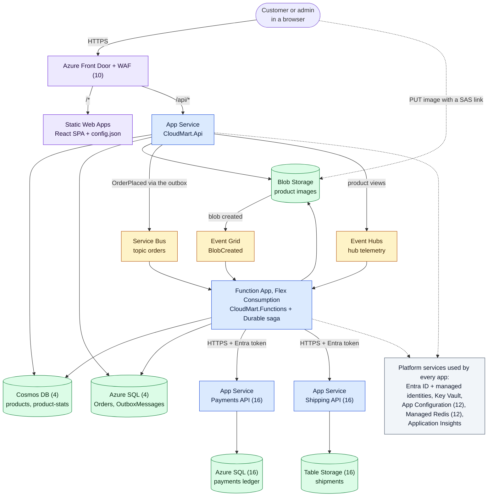
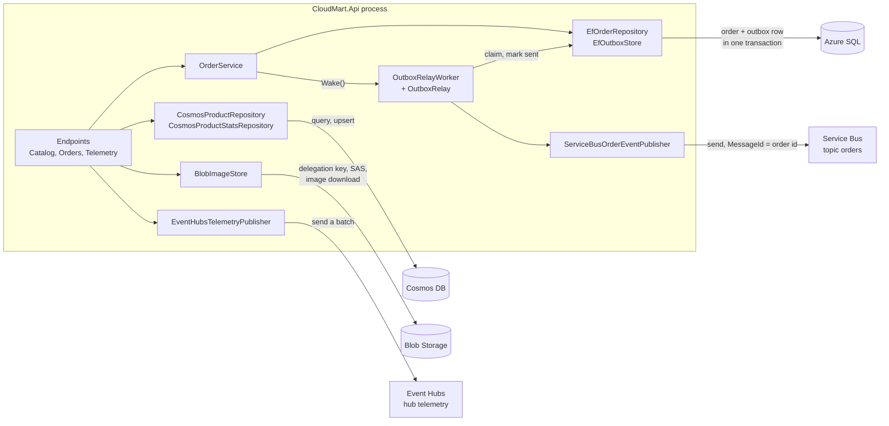
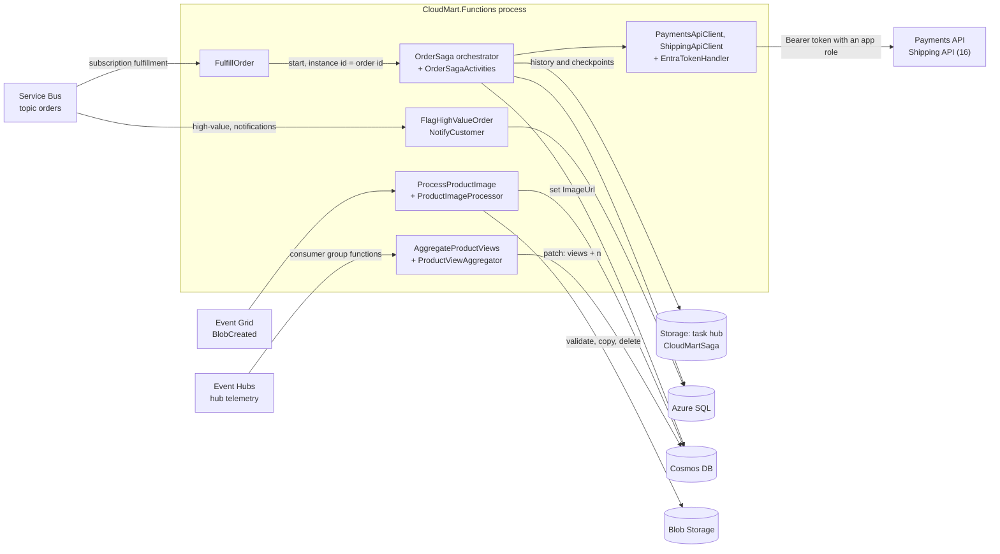
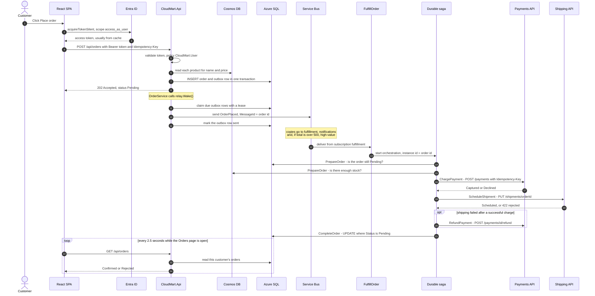
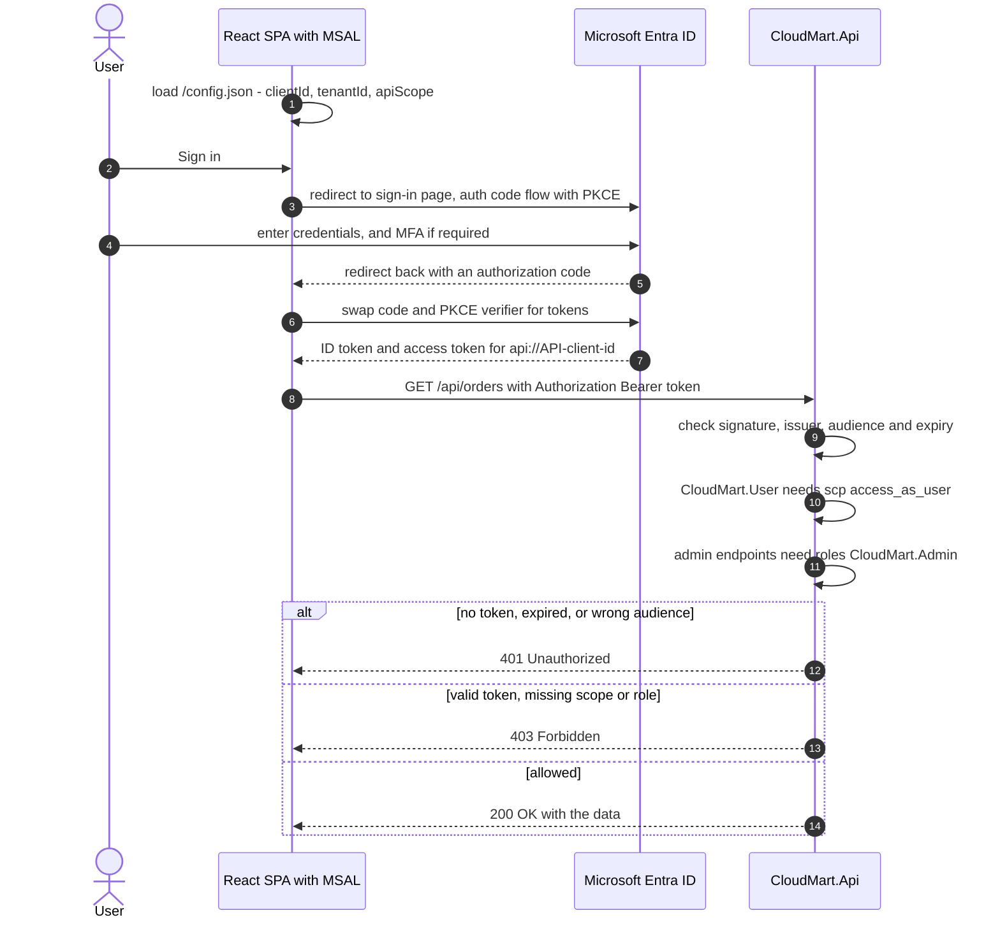
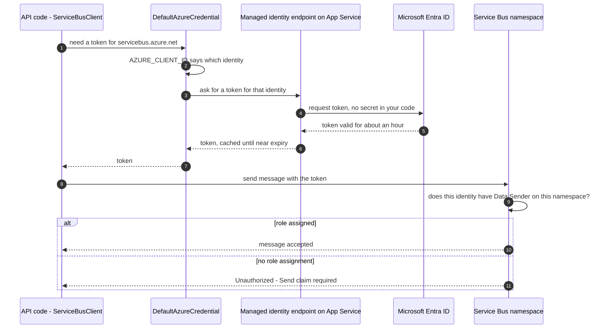
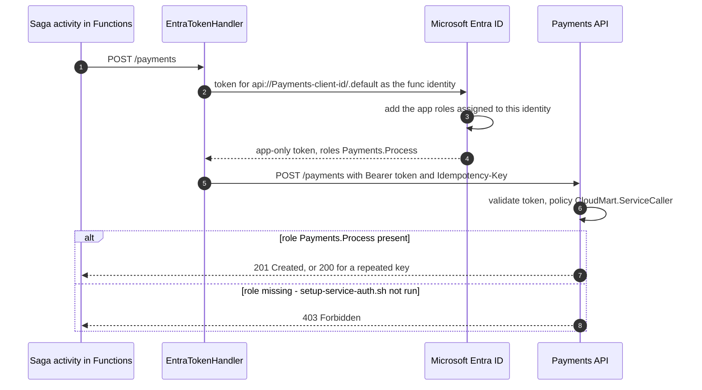
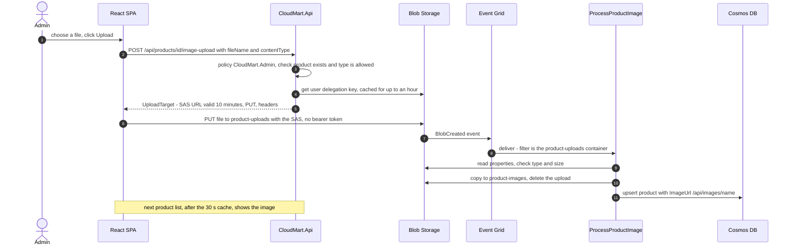
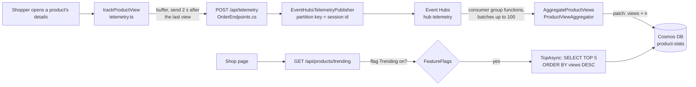

# CloudMart and Azure: a beginner's guide to the code

This guide explains every piece of Azure-related code in CloudMart: what it does, why it is there, how the parts talk
to each other, and how to configure, run and fix it. It assumes you know some C# or JavaScript but little or nothing
about Azure.

> **Never used the Azure portal?** Work through [portal-guide.pdf](portal-guide.pdf) first. It builds CloudMart's
> phase 1 resources by clicking, so the names in this guide (resource group, App Service, Key Vault...) will already
> be familiar. The labs themselves are in [learning-path.md](learning-path.md).

> **What this guide is based on.** The code on `main` at commit `7639ef0` (October 2026). Every file name, class,
> method, setting and line number was checked against that commit, and every diagram was drawn from the code, not
> from a generic Azure example. Line numbers move as the code changes; file, class and method names are the stable
> part. No real secrets appear anywhere: values in angle brackets, like `<your-account>`, are placeholders.

## How to read this guide

- **Sections 1 to 3** explain the big picture, then the code, then how the pieces connect.
- **Section 4** collects the diagrams. Sections 1, 3 and 5 point to them.
- **Section 5** follows real requests through the code, step by step.
- **Sections 6 to 8** are reference: configuration, deployment, troubleshooting and a glossary.

Every feature carries one of these labels, so you always know what is real:

| Label | Meaning |
|---|---|
| ✅ **Wired** | Implemented in code, and `infra/main.bicep` creates the Azure resource and the settings when you turn on its switch. |
| 🔧 **Manual step** | Implemented in code, but someone must run a script or do a portal step before it works. |
| 🔀 **Alternative** | Implemented, but only one option is active at a time (for example PostgreSQL instead of Azure SQL). |
| 📝 **Not in code** | A lab exercise or design discussion only. No application code exists for it. |

## Contents

- [Before you start: the ideas this guide uses](#before-you-start-the-ideas-this-guide-uses)
- [1. Overview of Azure development](#1-overview-of-azure-development)
- [2. Code implementation](#2-code-implementation)
- [3. Component integration and interaction](#3-component-integration-and-interaction)
- [4. Architecture and flow diagrams](#4-architecture-and-flow-diagrams)
- [5. Practical examples and execution flow](#5-practical-examples-and-execution-flow)
- [6. Configuration and deployment](#6-configuration-and-deployment)
- [7. Troubleshooting and common mistakes](#7-troubleshooting-and-common-mistakes)
- [8. Glossary and learning resources](#8-glossary-and-learning-resources)

---

## Before you start: the ideas this guide uses

Seven ideas come up on almost every page. Each one is explained in more detail in the
[glossary](#81-glossary).

1. **Resource.** Anything you create in Azure: a database, a web app, a storage account. Resources live in a
   **resource group** (a folder), inside a **subscription** (the billing account). CloudMart's resource group is
   `rg-cloudmart-dev`.

2. **Endpoint.** The web address of a resource, for example `https://<your-account>.documents.azure.com:443/` for a
   Cosmos DB account. CloudMart's code is given endpoints, never passwords.

3. **Microsoft Entra ID.** Azure's identity service (it used to be called Azure Active Directory). It checks who
   someone is and hands out **tokens**: short-lived, signed pieces of text that prove "this caller is X and may do Y".
   Every Azure service CloudMart talks to accepts an Entra ID token instead of a password.

4. **Managed identity.** An identity for a *program* rather than a person. Azure creates it, keeps its credentials
   and rotates them; your code never sees a secret. CloudMart has four, one per program: `id-cloudmart-dev-api`,
   `-func`, `-pay` and `-ship`.

5. **Role-based access control (RBAC).** How Azure decides what an identity may do. A **role assignment** joins three
   things: *who* (an identity), *what* (a role, such as "Azure Service Bus Data Sender") and *where* (a scope, such
   as one Service Bus namespace). No role assignment, no access, even with a valid token.

6. **Control plane and data plane.** The *control plane* creates and configures resources ("create a Cosmos DB
   account"). Bicep and the portal work there. The *data plane* uses what is inside them ("read product X"). All of
   CloudMart's application code works on the data plane, and data-plane access needs its own role, separate from
   roles like Owner or Contributor.

7. **SDK client.** A class from an Azure NuGet or npm package, such as `CosmosClient` or `ServiceBusClient`, that
   speaks the service's protocol for you. You give it an endpoint and a credential, and call ordinary C# methods.

---

## 1. Overview of Azure development

### 1.1 The design rule: every Azure service is optional

CloudMart runs on a laptop with **no Azure resources at all**. Every place where the app touches an outside service
is an *interface* with two implementations:

- a **local** one (in memory, or in the same process), used when nothing is configured, and
- an **Azure** one, used as soon as the matching setting has a value.

The comment at the top of [Abstractions.cs](../src/CloudMart.Core/Abstractions.cs#L8-L10) states the rule:

```csharp
// Every async boundary in CloudMart has two implementations: an in-memory/in-process one so the app runs on a
// laptop with zero Azure resources, and an Azure one that lights up when its configuration is present.
// See CloudMartServiceCollectionExtensions for the switch.
```

So "adding Azure" to CloudMart never means rewriting business logic. It means setting a value such as
`Cosmos__Endpoint`, which swaps one class for another at startup. The business code only ever sees the interface.

| What the app needs | Interface | Local version (no Azure) | Azure version | Setting that switches it | Phase |
|---|---|---|---|---|---|
| Product catalog | `IProductRepository` | `InMemoryProductRepository` | `CosmosProductRepository` | `Cosmos:Endpoint` | 4 |
| Product view counters | `IProductStatsRepository` | `InMemoryProductStatsRepository` | `CosmosProductStatsRepository` | `Cosmos:Endpoint` | 4 |
| Orders + outbox | `IOrderRepository`, `IOutboxStore` | `InMemoryOrderRepository`, `InMemoryOutboxStore` | `EfOrderRepository`, `EfOutboxStore` (Azure SQL or PostgreSQL) | `ConnectionStrings:OrdersSql` or `ConnectionStrings:OrdersPostgres` | 4 |
| Product images | `IImageStore` | `InMemoryImageStore` | `BlobImageStore` | `Storage:BlobEndpoint` | 1 (see note) |
| "Order placed" events | `IOrderEventPublisher` | `InProcessOrderEventPublisher` + `InProcessOrderWorker` | `ServiceBusOrderEventPublisher` + the Functions app | `ServiceBus:FullyQualifiedNamespace` | 5 |
| Click stream | `ITelemetryPublisher` | `InProcessTelemetryPublisher` | `EventHubsTelemetryPublisher` | `EventHubs:FullyQualifiedNamespace` | 5 |
| Taking payment | `IPaymentGateway` | `InProcessPaymentGateway` | `PaymentsApiClient` (calls the Payments API) | `Payments:BaseUrl` | 16 |
| Booking shipping | `IShippingGateway` | `InProcessShippingGateway` | `ShippingApiClient` (calls the Shipping API) | `Shipping:BaseUrl` | 16 |

A few Azure services aren't behind an interface because they plug into ASP.NET Core itself: Key Vault and
App Configuration (configuration sources), Application Insights (telemetry), Entra ID (sign-in) and Azure Managed
Redis (a cache). Each of those is also switched on by one setting; see [2.14](#214-the-api-host-key-vault-app-configuration-monitoring-sign-in-redis-front-door).

> **Note on images.** The storage account is created in phase 1, and Bicep always sets `Storage__BlobEndpoint`, so
> in Azure the API uses Blob Storage from day one. The Function that *processes* an upload is only triggered once
> the Event Grid subscription exists (phase 5). Before that, an uploaded image is stored but never attached to its
> product, and a lifecycle rule deletes it after a day. Locally, the API's stand-in endpoint attaches it at once.

The app shows which version is active on its **Platform** page. The values come from the `CloudMartProviders` record
that the startup code fills in ([CloudMartServiceCollectionExtensions.cs:198](../src/CloudMart.Core/CloudMartServiceCollectionExtensions.cs#L198)).

### 1.2 The Azure services CloudMart uses

The table lists each service, what it is in plain words, what CloudMart uses it for, and why it was chosen. The
"Code" column names the class that talks to it; section 2 explains each one.

| Service | In plain words | What CloudMart uses it for | Why this service | Switch (phase) | Code | Status |
|---|---|---|---|---|---|---|
| **Microsoft Entra ID** | The identity service: signs people in and issues tokens to people and programs | Customer and admin sign-in; tokens for every managed identity; service-to-service app roles | Standard OAuth 2.0 / OpenID Connect, so no passwords live in the app | Managed identities: always. Sign-in: `enableEntraAuth` (6) | [auth.tsx](../src/cloudmart-web/src/auth.tsx), [Program.cs](../src/CloudMart.Api/Program.cs#L54-L83), [ServiceApiClients.cs](../src/CloudMart.Core/Azure/ServiceApiClients.cs#L15-L24) | ✅ identities; 🔧 app registrations |
| **Managed identities** | Identities for programs, with no secret to manage | Each app proves who it is to Cosmos DB, SQL, Storage, Service Bus, Event Hubs, Key Vault, App Configuration and Redis | Removes every key and connection-string password from the code | Always (1) | `DefaultAzureCredential` everywhere | ✅ |
| **App Service** | Managed hosting for web apps: you upload code, Azure runs it | Hosts the API, and in phase 16 the Payments and Shipping APIs | Simple, cheap (B1), built-in health checks and identity | `deployAppService` (1, on) | [Program.cs](../src/CloudMart.Api/Program.cs) | ✅ |
| **Azure Functions** (Flex Consumption) | Small pieces of code that run when something happens (a message, an event, a timer) | Order processing, image processing, view counting, a daily report | Pay per run, scales to zero, triggers for Service Bus, Event Grid and Event Hubs built in | `deployFunctions` (1, on) | [CloudMart.Functions](../src/CloudMart.Functions) | ✅ (triggers disabled until phase 5) |
| **Durable Functions** | An extension of Functions that remembers where a long workflow got to | The order saga: check stock, charge, ship, refund if shipping fails | Survives restarts without double-charging; retries are durable | Comes with Functions + messaging (5) | [OrderSagaFunctions.cs](../src/CloudMart.Functions/OrderSagaFunctions.cs) | ✅ |
| **Static Web Apps** | Hosting for HTML, CSS and JavaScript files, served from many locations | Hosts the React front end (the SPA) | Free tier, global distribution, no server to run | `deployStaticWebApp` (1, on) | [staticwebapp.config.json](../src/cloudmart-web/public/staticwebapp.config.json), [config.ts](../src/cloudmart-web/src/config.ts) | ✅ |
| **Azure Cosmos DB for NoSQL** | A database of JSON documents, spread over partitions | Product catalog and product view counters | Flexible documents, fast key lookups, free tier | `deployCosmos` (4) | [CosmosRepositories.cs](../src/CloudMart.Core/Azure/CosmosRepositories.cs) | ✅ |
| **Azure SQL Database** | Microsoft SQL Server as a managed service | Orders and the outbox table; in phase 16 a separate `payments` database with a ledger table | Transactions: an order and its message must be saved together | `deploySql` (4) | [OrdersDb.cs](../src/CloudMart.Core/Azure/OrdersDb.cs), [LedgerPaymentStore.cs](../src/CloudMart.Payments/LedgerPaymentStore.cs) | ✅ + 🔧 database users |
| **Azure Database for PostgreSQL** | PostgreSQL as a managed service | The same orders data, as an alternative to SQL | Shows that one EF Core model runs on two engines | `deployPostgres` (4) | [OrdersDb.cs](../src/CloudMart.Core/Azure/OrdersDb.cs) | 🔀 + 🔧 database users |
| **Blob Storage** | Cheap storage for files ("blobs") in containers | Uploaded and published product images; also the Functions app's own storage and deployment package | Cheap, private by default, supports short-lived upload links (SAS) | Always (1) | [BlobImageStore.cs](../src/CloudMart.Core/Azure/BlobImageStore.cs) | ✅ |
| **Table Storage** | A simple key-value table inside the same storage account | Shipments (phase 16) | Every read is "the shipment for order X": a key lookup, very cheap | `deployShipping` (16) | [TableShipmentStore.cs](../src/CloudMart.Shipping/TableShipmentStore.cs) | ✅ |
| **Service Bus** | A reliable message broker with queues and topics | The `orders` topic: each placed order is a message, copied to three subscriptions | Retries, dead-lettering, filters and duplicate detection, which business messages need | `deployMessaging` (5) | [Messaging.cs](../src/CloudMart.Core/Azure/Messaging.cs#L12-L35), [OrderFunctions.cs](../src/CloudMart.Functions/OrderFunctions.cs) | ✅ |
| **Event Grid** | Delivers notifications that something happened ("a blob was created") | Tells a Function when the browser finishes uploading an image | Push delivery of discrete events, no polling | `deployEventGridSubscription` (5) | [CatalogFunctions.cs](../src/CloudMart.Functions/CatalogFunctions.cs#L21-L33) | ✅ |
| **Event Hubs** | Takes in large streams of small events, in order, per partition | Product-view click stream from browsers | Built for high-volume telemetry; several readers can each keep their own position | `deployMessaging` (5) | [Messaging.cs](../src/CloudMart.Core/Azure/Messaging.cs#L37-L56), [CatalogFunctions.cs](../src/CloudMart.Functions/CatalogFunctions.cs#L39-L50) | ✅ |
| **Key Vault** | A safe for secrets, keys and certificates | The `PaymentGateway--ApiKey` secret | Secrets leave the code and settings; every read is audited | Always (1) | [Program.cs](../src/CloudMart.Api/Program.cs#L23-L27) and Key Vault references | ✅ |
| **App Configuration** | Central settings and feature flags that apps reload without restarting | Banner message and the `Trending` feature flag | Change behaviour without a redeploy | `deployAppConfig` (12) | [Program.cs](../src/CloudMart.Api/Program.cs#L29-L38) | ✅ resource; 🔧 values set by hand |
| **Azure Managed Redis** | An in-memory cache shared by all servers | Second-level cache for product lists | Several API instances share one cache | `deployRedis` (12) | [Program.cs](../src/CloudMart.Api/Program.cs#L88-L101) | ✅ |
| **Application Insights + Log Analytics** (Azure Monitor) | Collects logs, traces and metrics, and lets you query and alert on them | Traces from browser to API to Service Bus to Functions; custom metrics; alerts | One place to see the whole system | Always (1) | [Program.cs](../src/CloudMart.Api/Program.cs#L45-L49), [telemetry.ts](../src/cloudmart-web/src/telemetry.ts), [CloudMartTelemetry.cs](../src/CloudMart.Core/CloudMartTelemetry.cs) | ✅ |
| **Front Door** (with WAF) | A global entry point that routes, caches and filters web traffic | One public address for the SPA and the API, image caching, and a lock so only Front Door reaches the API | Global edge, web application firewall | `deployFrontDoor` (10) | [Program.cs](../src/CloudMart.Api/Program.cs#L130-L143) | ✅ |

**Services with infrastructure but no application code.** Bicep can create these, but the app's code doesn't talk to
them (at most it detects them):

- **Container Apps, AKS, Container Registry:** other places to host the same API container. The code only
  *recognises* them, in [PlatformInfoProvider.cs](../src/CloudMart.Api/PlatformInfoProvider.cs#L71-L105).
- **Virtual network, private endpoints, Azure Firewall, Bastion, jumpbox:** network isolation. The code is unchanged,
  except one setting that switches Service Bus to WebSockets so the firewall can allow it (phase 13).
- **Application Gateway, API Management, Grafana, Azure Policy, budgets:** platform and governance features with no
  code at all. API Management and Logic Apps are 📝 lab exercises.

### 1.3 How the pieces fit together

Picture CloudMart in five layers. The [high-level architecture diagram](#41-high-level-architecture) shows them all.

1. **The front end.** The React SPA runs in the browser. Static Web Apps serves its files. It signs the user in with
   Entra ID (phase 6) and calls the API over HTTPS. Behind Front Door (phase 10), the SPA and API share one address.
2. **The API.** An ASP.NET Core app on App Service. It answers the browser **synchronously**: list products, place an
   order, hand out an upload link. It never waits for slow work like charging a card.
3. **The data.** Products live in Cosmos DB, orders in Azure SQL (or PostgreSQL), images in Blob Storage.
4. **The background work.** Anything slow or failure-prone happens **asynchronously**:
   - The API saves "order placed" as a message; Service Bus delivers it to the Functions app, which runs the order
     saga with Durable Functions.
   - Event Grid tells a Function about each image upload.
   - Event Hubs carries the click stream to a Function that counts product views.
5. **The platform.** Managed identities and Entra ID secure every connection, Key Vault holds the one secret, and
   Application Insights records what happens.

In phase 16 two more services appear: the **Payments API** (Azure SQL ledger) and the **Shipping API** (Table
Storage). The saga calls them over HTTPS with Entra ID tokens instead of calling in-process code.

### 1.4 Turning services on: the phase switches

The switches live in [infra/main.bicepparam](../infra/main.bicepparam). Each one makes Bicep create a resource
*and* set the app settings that make the code use it. The table shows the switches that change what the
application code does; the full list, including network and governance switches, is in the
[README](../README.md#deploy-to-azure).

| Phase | Switch (default) | Azure resources created | What the code starts doing |
|---|---|---|---|
| 1 | `deployAppService`, `deployFunctions`, `deployStaticWebApp` (all `true`) | App Service, Function App, Static Web App, Storage, Key Vault, Application Insights, 4 identities | API runs in Azure; images go to Blob Storage; telemetry to Application Insights; API reads Key Vault |
| 4 | `deployCosmos` (`false`) | Cosmos DB account, database `cloudmart`, containers `products` and `product-stats` | Catalog and view counters move to Cosmos DB |
| 4 | `deploySql` / `deployPostgres` (`false`) | Azure SQL server + database `cloudmart` / PostgreSQL server | Orders and the outbox table move to the database |
| 5 | `deployMessaging` (`false`) | Service Bus (topic `orders`), Event Hubs (hub `telemetry`), Event Grid system topic | Orders flow through Service Bus to Functions; clicks go to Event Hubs; the Functions triggers are enabled |
| 5 | `deployEventGridSubscription` (`false`) | Event Grid subscription `product-image-uploads` | Uploaded images are processed by a Function |
| 6 | `enableEntraAuth` + client ids (`false`) | Nothing new; you create two app registrations by hand first | API requires Entra ID tokens; SPA signs users in |
| 10 | `deployFrontDoor` (`false`) | Front Door profile, routes, WAF | API rejects traffic that didn't come through Front Door |
| 12 | `deployAppConfig`, `deployRedis` (`false`) | App Configuration store, Azure Managed Redis | Settings and feature flags reload live; product lists use a shared cache |
| 13 | `deployFirewall` (`false`) | Hub network and Azure Firewall | Service Bus traffic switches to AMQP over WebSockets (port 443) |
| 16 | `deployPayments`, `deployShipping` (`false`) | Payments and Shipping App Services, `payments` database, `shipments` table | The saga calls two separate APIs; only Payments may read the Key Vault secret |

> **Turn phases on in order.** The API and the Functions app are separate processes. With in-memory storage they
> cannot see each other's data, so if you switch on messaging (5) before a shared database (4), the Functions app
> receives orders it can't find, and they stay *Pending*. See [7.2](#72-symptoms-causes-and-fixes).

---

## 2. Code implementation

### 2.1 Where the Azure code lives

CloudMart has five .NET projects and one React app. The table sorts every file that touches Azure into three kinds:

- **Azure-specific:** the code exists *only* to talk to an Azure service.
- **Azure-aware wiring:** general startup code that decides *whether* to use Azure, based on settings.
- **General:** business logic and local stand-ins. It works the same with or without Azure.

| File | Kind | What it does |
|---|---|---|
| [CloudMart.Core/Azure/CosmosRepositories.cs](../src/CloudMart.Core/Azure/CosmosRepositories.cs) | Azure-specific | Catalog and view counters in Cosmos DB |
| [CloudMart.Core/Azure/OrdersDb.cs](../src/CloudMart.Core/Azure/OrdersDb.cs) | Azure-specific | Orders and the outbox in Azure SQL or PostgreSQL (EF Core) |
| [CloudMart.Core/Azure/BlobImageStore.cs](../src/CloudMart.Core/Azure/BlobImageStore.cs) | Azure-specific | Upload links (SAS), image processing and download from Blob Storage |
| [CloudMart.Core/Azure/Messaging.cs](../src/CloudMart.Core/Azure/Messaging.cs) | Azure-specific | Sends order events to Service Bus and clicks to Event Hubs |
| [CloudMart.Core/Azure/ServiceApiClients.cs](../src/CloudMart.Core/Azure/ServiceApiClients.cs) | Azure-specific | Calls the Payments and Shipping APIs with an Entra ID token |
| [CloudMart.Core/CloudMartServiceCollectionExtensions.cs](../src/CloudMart.Core/CloudMartServiceCollectionExtensions.cs) | Azure-aware wiring | Picks local or Azure implementations; creates every SDK client; seeds the catalog |
| [CloudMart.Core/CloudMartSettings.cs](../src/CloudMart.Core/CloudMartSettings.cs) | Azure-aware wiring | Reads the settings (endpoints, connection strings) into one object |
| [CloudMart.Core/CloudMartTelemetry.cs](../src/CloudMart.Core/CloudMartTelemetry.cs) | General (exported to Azure) | Custom traces and counters, sent to Application Insights by OpenTelemetry |
| [CloudMart.Api/Program.cs](../src/CloudMart.Api/Program.cs) | Azure-aware wiring | Key Vault, App Configuration, Application Insights, Entra ID, Redis, Front Door check |
| [CloudMart.Api/Auth.cs](../src/CloudMart.Api/Auth.cs) | Azure-specific | The Entra ID scope, app role and claims the API checks |
| [CloudMart.Api/PlatformInfoProvider.cs](../src/CloudMart.Api/PlatformInfoProvider.cs) | Azure-aware | Detects App Service, Container Apps, AKS or a VM, and reports which services are wired |
| [CloudMart.Api/Endpoints/*.cs](../src/CloudMart.Api/Endpoints) | General | The HTTP endpoints. They use interfaces only, never an SDK |
| [CloudMart.Functions/*.cs](../src/CloudMart.Functions), [host.json](../src/CloudMart.Functions/host.json) | Azure-specific | Azure Functions triggers and the Durable Functions saga host |
| [CloudMart.Payments/LedgerPaymentStore.cs](../src/CloudMart.Payments/LedgerPaymentStore.cs) | Azure-specific | Payments in an Azure SQL *ledger* table |
| [CloudMart.Shipping/TableShipmentStore.cs](../src/CloudMart.Shipping/TableShipmentStore.cs) | Azure-specific | Shipments in Azure Table Storage |
| [CloudMart.ServiceDefaults/ServiceDefaultsExtensions.cs](../src/CloudMart.ServiceDefaults/ServiceDefaultsExtensions.cs) | Azure-aware wiring | Shared by Payments and Shipping: Application Insights and Entra ID app-role checks |
| [CloudMart.ServiceDefaults/DependencyHealthCheck.cs](../src/CloudMart.ServiceDefaults/DependencyHealthCheck.cs) | General (used by Azure) | `/health/ready`, which App Service and Front Door probe |
| [cloudmart-web/src/auth.tsx](../src/cloudmart-web/src/auth.tsx) | Azure-specific | Entra ID sign-in with MSAL |
| [cloudmart-web/src/telemetry.ts](../src/cloudmart-web/src/telemetry.ts) | Azure-specific | Application Insights in the browser, plus the click stream |
| [cloudmart-web/src/config.ts](../src/cloudmart-web/src/config.ts), [public/config.json](../src/cloudmart-web/public/config.json) | Azure-aware | Runtime settings that the deployment writes |
| [cloudmart-web/src/api.ts](../src/cloudmart-web/src/api.ts) | Mostly general | Calls the API; `uploadImage` PUTs straight to Blob Storage |
| [cloudmart-web/public/staticwebapp.config.json](../src/cloudmart-web/public/staticwebapp.config.json) | Azure-specific | Static Web Apps routing and headers |
| `Domain/`, `Services/`, `Outbox/`, `Payments/`, `Shipping/`, `InMemory/`, `InProcess/` in CloudMart.Core | General | Business rules, the saga logic, the outbox pattern and the local stand-ins |

The infrastructure code ([infra/](../infra), 27 Bicep modules) and the pipeline ([pipelines/](../pipelines)) are also
Azure-specific. This guide covers them only where they configure the application;
[portal-guide.pdf](portal-guide.pdf) and [learning-path.md](learning-path.md) cover them in depth.

### 2.2 The Azure packages

Every Azure capability comes from a package. **Azure SDK** packages are named `Azure.*` (newer) or
`Microsoft.Azure.*` (older or framework-specific).

**NuGet (.NET):**

| Package | Project | What it gives the code |
|---|---|---|
| `Azure.Identity` | Core, Api, Shipping | `DefaultAzureCredential`: gets Entra ID tokens for managed identities and developers |
| `Microsoft.Azure.Cosmos` | Core | `CosmosClient`, `Container`: reads and writes Cosmos DB documents |
| `Microsoft.EntityFrameworkCore.SqlServer` | Core | EF Core for Azure SQL. Its SQL client understands `Authentication=Active Directory Managed Identity` |
| `Npgsql.EntityFrameworkCore.PostgreSQL` | Core | EF Core for Azure Database for PostgreSQL |
| `Azure.Storage.Blobs` | Core | `BlobServiceClient`: blobs, user delegation keys and SAS links |
| `Azure.Messaging.ServiceBus` | Core | `ServiceBusClient`, `ServiceBusSender`: sends messages |
| `Azure.Messaging.EventHubs` | Core | `EventHubProducerClient`: sends event batches |
| `Microsoft.Extensions.Http.Resilience` | Core | Retries, timeouts and a circuit breaker for the Payments and Shipping HTTP clients |
| `Azure.Data.Tables` | Shipping | `TableClient`: reads and writes table entities |
| `Azure.Extensions.AspNetCore.Configuration.Secrets` | Api | `AddAzureKeyVault`: loads Key Vault secrets into configuration |
| `Microsoft.Azure.AppConfiguration.AspNetCore` | Api | `AddAzureAppConfiguration`: settings and feature flags with live refresh |
| `Microsoft.FeatureManagement.AspNetCore` | Api | `IFeatureManager`: reads feature flags |
| `Microsoft.Azure.StackExchangeRedis` | Api | Entra ID sign-in to Azure Managed Redis |
| `Microsoft.Extensions.Caching.StackExchangeRedis`, `Microsoft.Extensions.Caching.Hybrid` | Api | The two-level cache (memory, then Redis) |
| `Microsoft.Identity.Web` | Api, ServiceDefaults | Validates Entra ID tokens on incoming requests |
| `Azure.Monitor.OpenTelemetry.AspNetCore` | Api, ServiceDefaults | `UseAzureMonitor()`: sends OpenTelemetry data to Application Insights |
| `Microsoft.Azure.Functions.Worker`, `.Sdk` | Functions | The Azure Functions isolated worker model |
| `Microsoft.Azure.Functions.Worker.Extensions.ServiceBus`, `.EventGrid`, `.EventHubs`, `.Timer` | Functions | The trigger attributes |
| `Microsoft.Azure.Functions.Worker.Extensions.DurableTask` | Functions | Durable Functions: orchestrations and activities |
| `Microsoft.ApplicationInsights.WorkerService`, `Microsoft.Azure.Functions.Worker.ApplicationInsights` | Functions | Application Insights for the Functions app |

**npm (the SPA):**

| Package | What it gives the code |
|---|---|
| `@azure/msal-browser`, `@azure/msal-react` | Microsoft Authentication Library: signs the user in and gets access tokens |
| `@microsoft/applicationinsights-web` | Application Insights in the browser: page views, timings, trace headers |

### 2.3 Settings: from an Azure app setting to a C# object

**How settings reach the code.** ASP.NET Core reads configuration from several sources and merges them, later
sources winning:

1. `appsettings.json` (committed; every Azure value is empty on purpose)
2. `appsettings.Development.json` and *user secrets* (only on your laptop)
3. **Environment variables.** In Azure, every *app setting* on an App Service or Function App becomes an
   environment variable.
4. Key Vault and App Configuration, when [Program.cs](../src/CloudMart.Api/Program.cs#L23-L38) adds them.

**The double underscore rule.** Configuration keys use `:` for nesting (`Cosmos:Endpoint`), but environment variable
names can't contain `:` on Linux. So Azure app settings use `__` instead: the app setting `Cosmos__Endpoint` arrives
as the key `Cosmos:Endpoint`. Bicep sets the `__` form; the code reads the `:` form.

**One object for all of it.** [CloudMartSettings.From](../src/CloudMart.Core/CloudMartSettings.cs#L46-L74) reads
every key once:

```csharp
public static CloudMartSettings From(IConfiguration config)
{
    var sql = Blank(config.GetConnectionString("OrdersSql"));
    var postgres = Blank(config.GetConnectionString("OrdersPostgres"));
    var ordersProvider = Blank(config["Orders:Provider"])
        ?? (sql is not null ? "SqlServer" : postgres is not null ? "PostgreSql" : "InMemory");

    return new CloudMartSettings
    {
        CosmosEndpoint = Blank(config["Cosmos:Endpoint"]),
        // ...
        ServiceBusNamespace = Blank(config["ServiceBus:FullyQualifiedNamespace"]),
        ServiceBusTransport = config.GetValue("ServiceBus:TransportType", ServiceBusTransportType.AmqpTcp),
        EventHubsNamespace = Blank(config["EventHubs:FullyQualifiedNamespace"]),
        BlobEndpoint = Blank(config["Storage:BlobEndpoint"]),
        PaymentsBaseUrl = Blank(config["Payments:BaseUrl"]),
        // ...
    };
}
```

Step by step:

1. `Blank(...)` turns an empty string into `null`. An empty setting means "not configured", so the local version stays.
2. The orders provider is guessed from whichever connection string is present, unless `Orders:Provider` says
   otherwise. That matters only when both SQL and PostgreSQL are deployed.
3. Asking for SQL without a connection string throws a clear error at startup (`Missing(...)`), instead of a confusing
   one later.

The settings that hold Azure endpoints are listed in [6.2](#62-how-the-app-is-configured-to-connect).

### 2.4 One credential for everything: `DefaultAzureCredential`

This is the most important piece of Azure code in CloudMart, and it is one line.
[AddCloudMartCore](../src/CloudMart.Core/CloudMartServiceCollectionExtensions.cs#L43-L47) creates a single credential and
hands it to every SDK client and both databases:

```csharp
// One credential for every Azure SDK client and both databases. In Azure it resolves to the managed
// identity whose client id is in AZURE_CLIENT_ID (or AKS workload identity); on a laptop it falls
// back to your `az login` / Visual Studio sign-in. No keys or connection-string secrets anywhere.
credential ??= new DefaultAzureCredential();
services.AddSingleton(credential);
```

**What it does.** `DefaultAzureCredential` (from `Azure.Identity`) tries a list of ways to get a token, in order, and
uses the first that works. Simplified:

1. **Environment:** a service principal described by environment variables. CloudMart doesn't use this.
2. **Workload identity:** used on AKS, where Kubernetes provides a token file.
3. **Managed identity:** used on App Service and Functions. Because CloudMart uses *user-assigned* identities, the
   app must say which one, so Bicep sets **`AZURE_CLIENT_ID`** to that identity's client id.
4. **Developer tools:** Visual Studio, Azure CLI (`az login`), Azure PowerShell, Azure Developer CLI. Used on your
   laptop.

**Why it matters.**

- The same code runs in Azure and on a laptop without changes; only *who* the token is for differs.
- No secrets exist: the app never holds a password, key or connection string with a credential in it.
- Tokens last about an hour. The credential caches and renews them, so the SDK clients don't ask Entra ID on every
  call.

**What it does not do.** A token proves *who* the caller is. Whether the caller may read a document or send a message
is decided by **role assignments** on each resource ([3.1](#31-how-the-app-reaches-each-azure-service)). Every
"403 Forbidden" in [section 7](#7-troubleshooting-and-common-mistakes) comes back to this.

The API creates its own credential in [Program.cs:18](../src/CloudMart.Api/Program.cs#L18) and passes it to
`AddCloudMartCore` so Key Vault, App Configuration and Redis share it. The Functions app lets `AddCloudMartCore`
create one. The Shipping API creates one for Table Storage
([Shipping/Program.cs:30](../src/CloudMart.Shipping/Program.cs#L30)).

### 2.5 The switchboard: `AddCloudMartCore`

[AddCloudMartCore](../src/CloudMart.Core/CloudMartServiceCollectionExtensions.cs#L37-L200) runs at startup in both
the API and the Functions app. For each boundary it checks one setting and registers either the Azure class or the
local one. The Cosmos DB branch shows the pattern:

```csharp
// Catalog + view counters: Cosmos DB (phase 4)
if (settings.CosmosEndpoint is { } cosmosEndpoint)
{
    services.AddSingleton(_ => new CosmosClient(cosmosEndpoint, credential, new CosmosClientOptions
    {
        ApplicationName = "CloudMart",
        UseSystemTextJsonSerializerWithOptions = CloudMartJson.Options,
    }));
    services.AddSingleton<CosmosProductRepository>();
    services.AddSingleton<IProductRepository>(sp => sp.GetRequiredService<CosmosProductRepository>());
    services.AddSingleton<IHealthProbe>(sp => sp.GetRequiredService<CosmosProductRepository>());
    services.AddSingleton<IProductStatsRepository, CosmosProductStatsRepository>();
    catalog = "Cosmos DB";
}
else
{
    services.AddSingleton<IProductRepository, InMemoryProductRepository>();
    services.AddSingleton<IProductStatsRepository, InMemoryProductStatsRepository>();
    catalog = "In-memory";
}
```

What to notice:

- **The client is a singleton.** Azure SDK clients are thread-safe and expensive to create (they open connections and
  cache tokens), so the app creates one per process and reuses it.
- **The endpoint plus the credential is all the client needs.** No key, no connection string.
- **The same class is registered three ways:** as the repository, and as an `IHealthProbe` so `/health/ready` can check
  that Cosmos DB answers ([2.14](#214-the-api-host-key-vault-app-configuration-monitoring-sign-in-redis-front-door)).
- **The `catalog` string** ends up on the Platform page.

The other branches follow the same shape:

| Lines | Boundary | Azure client created |
|---|---|---|
| [61-79](../src/CloudMart.Core/CloudMartServiceCollectionExtensions.cs#L61-L79) | Catalog | `CosmosClient` |
| [82-114](../src/CloudMart.Core/CloudMartServiceCollectionExtensions.cs#L82-L114) | Orders | `OrdersDbContext` on SQL Server or Npgsql |
| [122-135](../src/CloudMart.Core/CloudMartServiceCollectionExtensions.cs#L122-L135) | Images | `BlobServiceClient` |
| [138-152](../src/CloudMart.Core/CloudMartServiceCollectionExtensions.cs#L138-L152) | Order events | `ServiceBusClient` |
| [155-165](../src/CloudMart.Core/CloudMartServiceCollectionExtensions.cs#L155-L165) | Click stream | `EventHubProducerClient` for hub `telemetry` |
| [168-196](../src/CloudMart.Core/CloudMartServiceCollectionExtensions.cs#L168-L196) | Payments, Shipping | `HttpClient` with an Entra ID token handler |

**Seeding the catalog.** After startup, [InitializeCloudMartDataAsync](../src/CloudMart.Core/CloudMartServiceCollectionExtensions.cs#L215-L252)
does two things:

1. It creates the orders tables (`EnsureCreatedAsync`, then the outbox table).
2. It writes the eight sample products from `CatalogSeed` into the catalog *if the catalog is empty*. That is how a
   new Cosmos DB container fills itself.

It never throws. If the database is unreachable, it logs the error and the app starts anyway, so `/health/ready` can
show you what's wrong.

> **Status.** Creating tables from the app is a lab shortcut. The comment at
> [line 224](../src/CloudMart.Core/CloudMartServiceCollectionExtensions.cs#L224) says production would run EF Core
> migrations from the pipeline instead, so the app's identity would need only read/write rights. No migrations exist
> in the repository (📝).

### 2.6 Cosmos DB: the catalog and view counters

**Cosmos DB in one paragraph.** An *account* holds *databases*, a database holds *containers*, and a container holds
JSON *items* (documents). Each container has a **partition key**, a property that decides which physical partition an
item lives on. Reads that name the partition key are cheap; queries across all partitions cost more. Cost is measured
in *request units* (RU).

CloudMart has database `cloudmart` with two containers: `products` (partition key `/category`) and `product-stats`
(partition key `/id`).

[CosmosProductRepository](../src/CloudMart.Core/Azure/CosmosRepositories.cs#L12-L43) lists, reads and saves products:

```csharp
public Task<IReadOnlyList<Product>> ListAsync(string? category, CancellationToken ct = default)
{
    if (category is null)
        return _container.QueryAllAsync<Product>(new QueryDefinition("SELECT * FROM c ORDER BY c.name"), null, ct);

    return _container.QueryAllAsync<Product>(
        new QueryDefinition("SELECT * FROM c WHERE c.category = @category ORDER BY c.name").WithParameter("@category", category),
        new QueryRequestOptions { PartitionKey = new PartitionKey(category) },
        ct);
}
```

- With a category, the query names the partition key, so Cosmos DB reads one partition.
- The `@category` **parameter** prevents injection: the value is never pasted into the SQL text.
- `QueryAllAsync` ([line 89](../src/CloudMart.Core/Azure/CosmosRepositories.cs#L89-L97)) follows Cosmos DB's paging:
  results come back in pages, and the loop reads until `HasMoreResults` is false.
- `UpsertAsync` ([line 36](../src/CloudMart.Core/Azure/CosmosRepositories.cs#L36-L40)) inserts or replaces, and must
  be told the partition key (`product.Category`).

The partition key can't change. That's why the admin endpoint refuses to move a product to another category with
**409 Conflict** ([CatalogEndpoints.cs:51-56](../src/CloudMart.Api/Endpoints/CatalogEndpoints.cs#L51-L56)): in Cosmos DB
a "move" would be a delete plus an insert, and a plain upsert would create a duplicate.

[CosmosProductStatsRepository](../src/CloudMart.Core/Azure/CosmosRepositories.cs#L45-L85) counts views with a
**partial update** (patch):

```csharp
// Partial document update: increments server-side, so concurrent consumers don't overwrite each other.
private Task PatchAsync(string productId, PartitionKey partitionKey, int count, CancellationToken ct) =>
    _container.PatchItemAsync<ProductStats>(
        productId,
        partitionKey,
        [PatchOperation.Increment("/views", count), PatchOperation.Set("/updatedUtc", DateTimeOffset.UtcNow)],
        cancellationToken: ct);
```

The increment happens inside Cosmos DB, so two Functions running at once can't lose each other's counts. The error
handling around it ([lines 54-70](../src/CloudMart.Core/Azure/CosmosRepositories.cs#L54-L70)) is a typical Azure
pattern:

- **404 Not Found:** the counter doesn't exist yet, so create it.
- **409 Conflict:** someone else created it in the meantime, so patch again.

**Permissions.** The account has `disableLocalAuth: true`, so account keys don't work at all. Bicep gives the API
identity, the Functions identity and you the built-in **Cosmos DB Built-in Data Contributor** role
([main.bicep:415](../infra/main.bicep#L415)). This is a Cosmos DB *data-plane* role assignment: it does not appear in the
portal's *Access control (IAM)* blade.

### 2.7 Azure SQL and PostgreSQL: orders and the outbox

Orders need a *relational* database because one action must save two rows atomically: the order, and the message
announcing it (the **transactional outbox**, explained in [2.9](#29-service-bus-publishing-order-events-through-the-outbox)).
CloudMart uses Entity Framework (EF) Core with one model and two engines.

**Connecting without a password.** [The registration code](../src/CloudMart.Core/CloudMartServiceCollectionExtensions.cs#L84-L106)
differs per engine:

```csharp
case "SqlServer":
    // Entra auth lives in the connection string: "Authentication=Active Directory Managed Identity;
    // User Id=<identity client id>" in Azure, "Authentication=Active Directory Default" locally.
    services.AddDbContext<OrdersDbContext>(o => o.UseSqlServer(settings.OrdersConnectionString, sql => sql.EnableRetryOnFailure()));
    // ...
case "PostgreSql":
    var dataSourceBuilder = new NpgsqlDataSourceBuilder(settings.OrdersConnectionString);
    if (string.IsNullOrEmpty(dataSourceBuilder.ConnectionStringBuilder.Password))
    {
        // Entra auth for PostgreSQL: the "password" is a short-lived access token, refreshed periodically.
        dataSourceBuilder.UsePeriodicPasswordProvider(
            async (_, ct) => (await credential.GetTokenAsync(new TokenRequestContext(PostgresScopes), ct)).Token,
            TimeSpan.FromMinutes(30),
            TimeSpan.FromSeconds(10));
    }
```

- **SQL Server:** the SQL client library fetches the token itself. The connection string Bicep builds
  ([main.bicep:532-533](../infra/main.bicep#L532-L533)) contains no password:
  `Server=tcp:<server>.database.windows.net,1433;Database=cloudmart;Authentication=Active Directory Managed Identity;User Id=<identity client id>;Encrypt=True;Connect Timeout=30;`
- **PostgreSQL:** Npgsql has no built-in Entra support, so the code asks `DefaultAzureCredential` for a token for
  `https://ossrdbms-aad.database.windows.net/.default` and passes it as the password. It renews it every 30 minutes.
- **`EnableRetryOnFailure()`** retries brief cloud errors, such as a serverless database waking from auto-pause.

**Permissions are inside the database.** Azure RBAC doesn't control who can read a table. Each identity needs a
*database user*, created by the SQL script
[deploy/sql/grant-managed-identities.sql](../deploy/sql/grant-managed-identities.sql) or the PostgreSQL script
[deploy/postgres/grant-managed-identities.sql](../deploy/postgres/grant-managed-identities.sql), run once by an Entra
admin (🔧). Bicep makes *you* that admin and turns password logins off.

**The repository.** [EfOrderRepository](../src/CloudMart.Core/Azure/OrdersDb.cs#L94-L167) saves the order and its
outbox message in one `SaveChangesAsync`, which is one transaction:

```csharp
public async Task AddAsync(Order order, OutboxMessage placed, CancellationToken ct = default)
{
    // One SaveChanges is one transaction: both rows are committed, or neither is.
    db.Orders.Add(order);
    db.OutboxMessages.Add(placed);
    // ...
    await db.SaveChangesAsync(ct);
```

`TryCompleteAsync` ([line 128](../src/CloudMart.Core/Azure/OrdersDb.cs#L128-L142)) finishes an order with a
conditional `UPDATE ... WHERE Status = 'Pending'`. If two consumers try to complete the same order, only the first
updates a row; the second gets `false` and does nothing. That makes order processing **idempotent**: safe to repeat.

[EfOutboxStore.ClaimAsync](../src/CloudMart.Core/Azure/OrdersDb.cs#L193-L227) lets several API instances share the
outbox table. One SQL statement picks due messages and "leases" them:

- **SQL Server:** `WITH (ROWLOCK, UPDLOCK, READPAST)`.
- **PostgreSQL:** `FOR UPDATE SKIP LOCKED`.

Rows that another instance has locked are skipped rather than waited for.

[OrdersDbContext.CreateOutboxTableSql](../src/CloudMart.Core/Azure/OrdersDb.cs#L56-L91) creates the outbox table with
"if not exists" DDL for each engine. `CheckAsync` runs `SELECT 1` so the readiness probe shows the real database error,
such as *Login failed for user '&lt;token-identified principal&gt;'*.

### 2.8 Blob Storage: product images with a valet key

**The problem.** Uploading a file through the API ties up the API and doubles the traffic. But giving the browser
the storage account's key would be dangerous, and CloudMart's account has shared keys turned off
(`allowSharedKeyAccess: false`).

**The solution: the valet-key pattern.** The API hands the browser a **SAS** (shared access signature): a URL with a
signature that allows *one* action on *one* blob for *a few minutes*. The browser uploads straight to Blob Storage.
Because keys are off, CloudMart signs the SAS with a **user delegation key**, a temporary key that Blob Storage issues
to the API's managed identity.

[BlobImageStore.CreateUploadTargetAsync](../src/CloudMart.Core/Azure/BlobImageStore.cs#L26-L50):

```csharp
var blobName = ImageRules.CreateUploadName(productId, fileName);
var expires = DateTimeOffset.UtcNow.AddMinutes(10);
var sas = new BlobSasBuilder(BlobSasPermissions.Create | BlobSasPermissions.Write, expires)
{
    BlobContainerName = _uploads.Name,
    BlobName = blobName,
    Resource = "b",
    StartsOn = DateTimeOffset.UtcNow.AddMinutes(-5), // tolerate clock skew
};

var key = await GetDelegationKeyAsync(ct);
var uri = new BlobUriBuilder(_uploads.GetBlobClient(blobName).Uri)
{
    Sas = sas.ToSasQueryParameters(key, service.AccountName),
}.ToUri();
```

Step by step:

1. **Name the blob** `{productId}/{random}-{fileName}`, so the processor can later tell which product it belongs to.
2. **Limit the SAS** to *create* and *write*, one blob (`Resource = "b"`), for 10 minutes. It can't read or list anything.
3. **Get a user delegation key** ([GetDelegationKeyAsync](../src/CloudMart.Core/Azure/BlobImageStore.cs#L99-L119)). The
   key is valid for an hour, and the code caches it and renews it 15 minutes before expiry. This needs the
   **Storage Blob Delegator** role.
4. **Sign** the SAS and return the URL with the headers the browser must send (`x-ms-blob-type: BlockBlob`).

Two more methods complete the picture:

- [PromoteUploadAsync](../src/CloudMart.Core/Azure/BlobImageStore.cs#L65-L95) runs later, in a Function. It checks the
  uploaded blob's type and size (PNG, JPEG, WebP or GIF, up to 5 MB), copies it from `product-uploads` to
  `product-images`, then deletes the upload. If the blob is already gone, it returns quietly: Event Grid can deliver
  the same event twice.
- [OpenReadAsync](../src/CloudMart.Core/Azure/BlobImageStore.cs#L52-L63) streams an image *through the API*
  (`GET /api/images/{name}`). The containers stay private, and Front Door caches the images at the edge.

**Permissions.** The API identity has **Storage Blob Data Contributor** and **Storage Blob Delegator** on the account.
The Functions identity has **Storage Blob Data Owner**, plus queue and table roles for its own host storage. The
storage account's CORS rule allows `PUT` from the SPA's origins, because the browser uploads cross-origin.

### 2.9 Service Bus: publishing order events through the outbox

**Service Bus in one paragraph.** A **namespace** is the Service Bus server. A **topic** is a named mailbox you send
to. Each **subscription** on a topic gets its own copy of every message. Unlike a plain queue, one message reaches
several independent readers. A subscription can have a **filter**, and a message that keeps failing moves to a
**dead-letter queue** instead of blocking the others.

CloudMart has one topic, **`orders`**, with three subscriptions (see [messaging.bicep](../infra/modules/messaging.bicep#L68-L105)):

| Subscription | Filter | Tries before dead-letter | Read by Function |
|---|---|---|---|
| `fulfillment` | all messages | 3 | `FulfillOrder` |
| `notifications` | all messages | 5 | `NotifyCustomer` |
| `high-value` | SQL filter `total > 500` | 5 | `FlagHighValueOrder` |

The topic has **duplicate detection** on, with a 10-minute window.

**Sending.** [ServiceBusOrderEventPublisher](../src/CloudMart.Core/Azure/Messaging.cs#L12-L35):

```csharp
var message = new ServiceBusMessage(BinaryData.FromObjectAsJson(evt, CloudMartJson.Options))
{
    // The topic has duplicate detection on, so a retried publish of the same order is dropped.
    MessageId = evt.OrderId.ToString(),
    Subject = nameof(OrderPlaced),
    ContentType = "application/json",
    CorrelationId = evt.CustomerId,
};

// Subscription SQL filters evaluate application properties, not the body.
message.ApplicationProperties["total"] = (double)evt.Total;
message.ApplicationProperties["itemCount"] = evt.ItemCount;

await _sender.SendMessageAsync(message, ct);
```

- **The body** is the `OrderPlaced` record as JSON (its shape is in [3.4](#34-the-data-that-travels-between-components)).
- **`MessageId` = the order id**, so if the same order is sent twice, Service Bus drops the copy.
- **`total` is copied into an application property** because subscription filters can't look inside the body. That's
  how `high-value` sees only orders over 500.
- **The sender is created once** per topic ([line 14](../src/CloudMart.Core/Azure/Messaging.cs#L14)) and reused.

**Why the API doesn't send straight from the checkout request: the transactional outbox.** A database transaction
can't include a Service Bus send. "Save the order, then send the message" can fail between the two steps, leaving an
order nobody processes. So CloudMart:

1. saves the message as a row in the `OutboxMessages` table, *in the same transaction as the order*
   ([2.7](#27-azure-sql-and-postgresql-orders-and-the-outbox)), and
2. lets a background **relay** send the rows afterwards, retrying until Service Bus accepts them.

The relay is [OutboxRelay](../src/CloudMart.Core/Outbox/OutboxRelay.cs#L15-L77), run by `OutboxRelayWorker`
([line 86](../src/CloudMart.Core/Outbox/OutboxRelay.cs#L86-L120)) inside the API.

- **When it runs:** at startup, whenever `OrderService` saves an order (it calls `relay.Wake()`), and when a retry
  falls due. It never polls on a timer, so an idle app leaves the database alone and a serverless Azure SQL database
  can pause.
- **Failed sends:** they are retried after 5, 10, 20 and 40 seconds, then every minute (`Backoff`,
  [line 39](../src/CloudMart.Core/Outbox/OutboxRelay.cs#L39-L40)).
- **Tracing:** each send continues the checkout request's trace, using the `TraceParent` stored with the row
  ([lines 46-47](../src/CloudMart.Core/Outbox/OutboxRelay.cs#L46-L47)). Application Insights then shows the checkout
  and the Function that processed it as one transaction.

The outbox *pattern* is general code; it would work with any broker. What makes it necessary is that Service Bus is a
separate system from the database.

**Permissions and network.**

- The API identity has **Azure Service Bus Data Sender**; the Functions identity has **Azure Service Bus Data
  Receiver**. The namespace has local (key) authentication disabled.
- The client normally uses AMQP on port 5671. Behind the phase 13 firewall, the setting `ServiceBus__TransportType`
  switches it to AMQP over WebSockets on port 443
  ([CloudMartServiceCollectionExtensions.cs:140-141](../src/CloudMart.Core/CloudMartServiceCollectionExtensions.cs#L140-L141)).

### 2.10 Event Hubs: the click stream

**Event Hubs in one paragraph.** An Event Hubs **namespace** holds **event hubs**. A hub is split into
**partitions**; events with the same **partition key** land in the same partition and stay in order. Readers belong
to a **consumer group**, and each group keeps its own place in the stream, so several readers can process the same
events independently. Event Hubs suits many small events (telemetry); Service Bus suits fewer, important business
messages.

CloudMart has hub **`telemetry`** (2 partitions, 24-hour retention) and consumer group **`functions`**.

The browser batches product views and posts them to `POST /api/telemetry`
([OrderEndpoints.cs:59-70](../src/CloudMart.Api/Endpoints/OrderEndpoints.cs#L59-L70)). The endpoint accepts 1 to 100
events and drops malformed ones. [EventHubsTelemetryPublisher](../src/CloudMart.Core/Azure/Messaging.cs#L38-L56)
then sends them:

```csharp
// Same partition key => same partition => one browser session's events stay in order.
var options = new CreateBatchOptions { PartitionKey = events[0].SessionId ?? "anonymous" };
using var batch = await producer.CreateBatchAsync(options, ct);
foreach (var e in events)
{
    if (!batch.TryAdd(new EventData(BinaryData.FromObjectAsJson(e, CloudMartJson.Options)) { ContentType = "application/json" }))
        throw new InvalidOperationException("The telemetry payload does not fit in a single Event Hubs batch.");
}

await producer.SendAsync(batch, ct);
```

A batch is sent in one network call. `TryAdd` returns `false` if the batch would exceed the size limit, which can't
happen with 100 small events, but the code fails loudly rather than drop data silently.

**Permissions.** API identity: **Azure Event Hubs Data Sender**. Functions identity: **Azure Event Hubs Data
Receiver**.

### 2.11 The Functions app: code that runs when something happens

**Functions in one paragraph.** A *function* is a method with a **trigger** attribute. The Functions *host* watches
the trigger's source (a subscription, a hub, a timer) and calls the method when something arrives. CloudMart uses the
**isolated worker** model: your code runs in its own .NET 10 process, next to the host. It runs on the **Flex
Consumption** plan, which scales with load and to zero when idle.

**Startup.** [Program.cs](../src/CloudMart.Functions/Program.cs) is short because it reuses everything from Core:

```csharp
var builder = FunctionsApplication.CreateBuilder(args);
builder.ConfigureFunctionsWebApplication();
builder.Services
    .AddApplicationInsightsTelemetryWorkerService()
    .ConfigureFunctionsApplicationInsights();
// ...
// Same services as the API. The Functions host owns the triggers, so no in-process worker is registered here.
builder.Services.AddCloudMartCore(builder.Configuration, CloudMartHost.Functions);
```

`AddCloudMartCore` with `CloudMartHost.Functions` registers the same repositories and clients as the API. It skips the
outbox relay and the in-process worker, because in Azure the Functions host delivers the messages.

**The functions.**

| Function | Trigger | Listens to | What it does | Code |
|---|---|---|---|---|
| `FulfillOrder` | Service Bus | topic `orders`, subscription `fulfillment` | Starts the order saga (2.12) | [OrderFunctions.cs:24-44](../src/CloudMart.Functions/OrderFunctions.cs#L24-L44) |
| `FlagHighValueOrder` | Service Bus | `orders` / `high-value` (total > 500) | Marks the order for manual review | [OrderFunctions.cs:47-51](../src/CloudMart.Functions/OrderFunctions.cs#L47-L51) |
| `NotifyCustomer` | Service Bus | `orders` / `notifications` | Logs a notification. **It doesn't send an email** (📝, the comment suggests Communication Services or a Logic App) | [OrderFunctions.cs:53-56](../src/CloudMart.Functions/OrderFunctions.cs#L53-L56) |
| `ProcessProductImage` | Event Grid | `BlobCreated` events from the storage account | Validates the upload and attaches it to its product | [CatalogFunctions.cs:21-33](../src/CloudMart.Functions/CatalogFunctions.cs#L21-L33) |
| `AggregateProductViews` | Event Hubs | hub `telemetry`, consumer group `functions` | Counts views per product and patches Cosmos DB | [CatalogFunctions.cs:39-50](../src/CloudMart.Functions/CatalogFunctions.cs#L39-L50) |
| `DailyOrderReport` | Timer | `0 0 6 * * *` (06:00 UTC daily) | Summarises the last 24 hours. **It only logs** the summary | [CatalogFunctions.cs:53-60](../src/CloudMart.Functions/CatalogFunctions.cs#L53-L60) |
| `OrderSaga` + 5 activities | Durable orchestration / activity | Started by `FulfillOrder` | The saga steps (2.12) | [OrderSagaFunctions.cs](../src/CloudMart.Functions/OrderSagaFunctions.cs) |

A Service Bus trigger looks like this:

```csharp
[Function(nameof(FulfillOrder))]
public async Task FulfillOrder(
    [ServiceBusTrigger("orders", "fulfillment", Connection = "ServiceBus")] ServiceBusReceivedMessage message,
    [DurableClient] DurableTaskClient durable,
    CancellationToken ct)
```

**`Connection = "ServiceBus"` is a prefix, not a connection string.** The host looks for app settings that start with
`ServiceBus__`. Bicep sets three ([main.bicep:604-609](../infra/main.bicep#L604-L609)):

```text
ServiceBus__fullyQualifiedNamespace = <namespace>.servicebus.windows.net
ServiceBus__credential              = managedidentity
ServiceBus__clientId                = <Functions identity client id>
```

This is an **identity-based connection**: the host signs in to Service Bus as the managed identity. The Event Hubs
trigger works the same way with the `EventHubs__` prefix. The host's own storage uses
`AzureWebJobsStorage__accountName`, `__credential` and `__clientId`
([main.bicep:592-595](../infra/main.bicep#L592-L595)) instead of the usual storage connection string.

> **Watch the spelling.** The API reads `ServiceBus__FullyQualifiedNamespace` (capital F) through `CloudMartSettings`.
> The Functions trigger reads `ServiceBus__fullyQualifiedNamespace` (lower-case f), the name the Functions host
> expects. Bicep sets each app the form it needs.

**Error handling in a trigger.**

- If a Service Bus function throws, the message is *abandoned* and Service Bus delivers it again, up to the
  subscription's limit (3 for `fulfillment`). Then it goes to the dead-letter queue. Ticking *simulate failure* at
  checkout makes `FulfillOrder` throw on purpose (`ThrowIfSimulatedFailure`) so you can watch this.
- If it returns normally, the message is completed (`autoCompleteMessages: true` in [host.json](../src/CloudMart.Functions/host.json#L25-L28)).

**Disabled until phase 5.** Until messaging is deployed there is nothing to listen to, so Bicep sets
`AzureWebJobs.FulfillOrder.Disabled = true` and the same for the other three message triggers
([main.bicep:612-616](../infra/main.bicep#L612-L616)). `DailyOrderReport` stays disabled until a database exists.

**Event Grid needs no connection setting.** The Event Grid *subscription* (Bicep) names the Function as its endpoint,
and Azure delivers events straight to it. The function checks the event type and the container prefix and ignores
anything else ([lines 25-30](../src/CloudMart.Functions/CatalogFunctions.cs#L25-L30)).

### 2.12 Durable Functions: the order saga

**What a saga is.** Placing an order touches several systems: stock (Cosmos DB), payment, shipping and the orders
database. No single transaction can cover them all. A **saga** runs the steps one by one, and if a later step fails,
it runs a **compensating** step to undo an earlier one: here, *refund* the payment if shipping fails.

**The logic is general code.** [OrderSaga.RunAsync](../src/CloudMart.Core/Services/OrderSaga.cs#L39-L51) and
[ChargeAndShipAsync](../src/CloudMart.Core/Services/OrderSaga.cs#L53-L106) contain the business rules: prepare, charge,
ship, refund on failure, and complete. They call the steps through an interface, `IOrderSagaContext`, and know nothing
about Azure.

**Durable Functions makes it survive crashes.** [OrderSagaFunctions](../src/CloudMart.Functions/OrderSagaFunctions.cs)
plugs the same logic into Durable Functions:

```csharp
[Function(Orchestrator)]
public static Task<OrderOutcome?> RunOrderSaga([OrchestrationTrigger] TaskOrchestrationContext context) =>
    OrderSaga.RunAsync(new DurableOrderSagaContext(context), context.GetInput<OrderPlaced>()!);
```

`DurableOrderSagaContext` ([lines 46-67](../src/CloudMart.Functions/OrderSagaFunctions.cs#L46-L67)) turns each step into
an **activity function** call with a retry policy: 3 attempts, 5 then 10 seconds apart.

How it works:

- Durable Functions saves every step's result in a **task hub**: tables and queues in the storage account, named
  `CloudMartSaga` in [host.json](../src/CloudMart.Functions/host.json#L19).
- After a crash, scale-in or redeploy, the orchestrator **replays** from that history. Completed steps return their
  saved result instead of running again, so a customer is never charged twice.
- That replay is why the orchestrator must be **deterministic**: no clocks, random numbers or I/O inside
  `OrderSaga.RunAsync`. All real work happens in the activities.

**Starting it exactly once.** `FulfillOrder` uses the order id as the saga's *instance id*
([OrderFunctions.cs:35-42](../src/CloudMart.Functions/OrderFunctions.cs#L35-L42)). If Service Bus delivers the message
again, the function finds the saga already exists and does nothing.

**The steps** are in [OrderSagaActivities](../src/CloudMart.Core/Services/OrderSaga.cs#L112-L178):

1. **Prepare:** load the order; stop if it's no longer *Pending*; check stock in the catalog. A 1.5-second pause
   (`Fulfillment:SimulatedDelayMs`) lets you watch *Pending* in the UI.
2. **Charge** through `IPaymentGateway`.
3. **Ship** through `IShippingGateway`.
4. **Refund**, only if shipping failed after a successful charge.
5. **Complete:** set the final status with the conditional update from 2.7. If a refund failed, it logs an error that
   the "orders need review" alert in [monitoring.bicep](../infra/modules/monitoring.bicep) matches.

**Locally,** the same `OrderSaga.RunAsync` runs through `InProcessOrderSagaContext`
([OrderSaga.cs:181-188](../src/CloudMart.Core/Services/OrderSaga.cs#L181-L188)), called by `InProcessOrderWorker`.
It has no checkpoints: if the process stops mid-saga, that order stays *Pending*.

### 2.13 Payments and Shipping: calling other services with a token (phase 16)

In phase 16, payment and shipping move out of the main app into two small APIs, each with its own database. The
saga's `IPaymentGateway` and `IShippingGateway` switch from in-process classes to HTTP clients.

**Getting a token for another service.** [EntraTokenHandler](../src/CloudMart.Core/Azure/ServiceApiClients.cs#L15-L24)
sits in the HTTP client's pipeline and adds a bearer token to every request:

```csharp
public sealed class EntraTokenHandler(TokenCredential credential, string scope) : DelegatingHandler
{
    protected override async Task<HttpResponseMessage> SendAsync(HttpRequestMessage request, CancellationToken cancellationToken)
    {
        // The credential caches the token until shortly before it expires, so this is not a round trip per call.
        var token = await credential.GetTokenAsync(new TokenRequestContext([scope]), cancellationToken);
        request.Headers.Authorization = new AuthenticationHeaderValue("Bearer", token.Token);
        return await base.SendAsync(request, cancellationToken);
    }
}
```

- The **scope** is `api://<Payments API client id>/.default` (setting `Payments:Scope`). It means "a token for the
  Payments API's app registration, with whatever app roles I've been given".
- The caller is a managed identity, so the token is an **app-only** token: it carries a `roles` claim
  (`Payments.Process`) and no user.
- The roles are assigned by [deploy/entra/setup-service-auth.sh](../deploy/entra/setup-service-auth.sh) (🔧), which
  creates the *CloudMart Payments* and *CloudMart Shipping* app registrations and gives the API and Functions
  identities their roles.

[AddServiceClient](../src/CloudMart.Core/CloudMartServiceCollectionExtensions.cs#L202-L212) also adds
`AddStandardResilienceHandler()`: a timeout per attempt, retries with exponential backoff for 5xx, 408, 429 and network
errors, and a circuit breaker that fails fast while a service is down.

**Retrying a payment safely.** Retrying a charge could charge twice, so every attempt sends the same
`Idempotency-Key: charge-<order id>` header ([PaymentsApiClient.ChargeAsync](../src/CloudMart.Core/Azure/ServiceApiClients.cs#L34-L43),
key defined in [Payments.cs:42](../src/CloudMart.Core/Payments/Payments.cs#L42)). The Payments API returns the first
result for a repeated key. Shipping uses `PUT /shipments/{orderId}`, which is idempotent by definition.

**The Payments API** ([CloudMart.Payments/Program.cs](../src/CloudMart.Payments/Program.cs)):

- Accepts only tokens carrying the `Payments.Process` app role (`AddCloudMartServiceAuth`, below).
- Stores payments in Azure SQL in an **updatable ledger table** (`LEDGER = ON`). SQL Server keeps a cryptographically
  chained history of every change, so nobody can quietly rewrite a payment
  ([LedgerPaymentStore.cs:36-53](../src/CloudMart.Payments/LedgerPaymentStore.cs#L36-L53)).
- Reads the payment-gateway key from configuration. In Azure that setting is a **Key Vault reference** (2.14). The
  code only ever shows its last four characters, as proof it arrived
  ([Payments.cs:89-90](../src/CloudMart.Core/Payments/Payments.cs#L89-L90)).

**The Shipping API** ([CloudMart.Shipping/Program.cs](../src/CloudMart.Shipping/Program.cs)) stores shipments in
**Table Storage**:

```csharp
var tables = !string.IsNullOrEmpty(tableConnection)
    ? new TableServiceClient(tableConnection)
    : new TableServiceClient(new Uri(tableEndpoint!), new DefaultAzureCredential());
builder.Services.AddSingleton(tables.GetTableClient(config["Shipping:TableName"] ?? "shipments"));
```

- In Azure it uses the `Shipping:TableEndpoint` setting and the managed identity (role **Storage Table Data
  Contributor**).
- The `ConnectionStrings:ShipmentsTable` option exists for the local storage emulator, Azurite.

[TableShipmentStore](../src/CloudMart.Shipping/TableShipmentStore.cs) uses two common Table Storage techniques:

- **The insert is the duplicate check.** `AddEntityAsync` fails with **409** if the shipment exists, and the code then
  returns the existing one.
- **Optimistic concurrency.** A cancel updates only if the entity's **ETag** hasn't changed since it was read;
  otherwise Azure answers **412**.

**Shared service code.** [ServiceDefaultsExtensions.AddCloudMartServiceAuth](../src/CloudMart.ServiceDefaults/ServiceDefaultsExtensions.cs#L56-L83)
gives both services the same Entra ID setup: validate the token with `Microsoft.Identity.Web`, read roles from the
`roles` claim, and require the service's role on every endpoint.

### 2.14 The API host: Key Vault, App Configuration, monitoring, sign-in, Redis, Front Door

[CloudMart.Api/Program.cs](../src/CloudMart.Api/Program.cs) wires the Azure services that plug into ASP.NET Core
itself. Each block is skipped when its setting is empty.

**Key Vault as a configuration source** ([lines 23-27](../src/CloudMart.Api/Program.cs#L23-L27)):

```csharp
if (config["KeyVault:Uri"] is { Length: > 0 } keyVaultUri)
{
    // Secret "PaymentGateway--ApiKey" becomes configuration key "PaymentGateway:ApiKey".
    config.AddAzureKeyVault(new Uri(keyVaultUri), credential);
}
```

At startup, the provider reads every secret the identity may read and adds it to configuration. Secret names can't
contain `:`, so `--` stands in for it. Needs the **Key Vault Secrets User** role.

CloudMart reads the same secret a second way: a **Key Vault reference**. The Functions app (before phase 16) and the
Payments API get an app setting whose *value* is
`@Microsoft.KeyVault(VaultName=<vault>;SecretName=PaymentGateway--ApiKey)`
([main.bicep:557](../infra/main.bicep#L557)). App Service resolves it using the site's identity, and the code just
reads `PaymentGateway:ApiKey` like any other setting.

| | Configuration provider (API) | Key Vault reference (Functions, Payments) |
|---|---|---|
| Who reads the vault | Your code, at startup | The App Service platform |
| Code needed | `AddAzureKeyVault` | None |
| Picking up a new secret version | Restart the app | Automatic, within about a day, or on restart |

In phase 16 only the Payments API keeps access to the secret: Bicep removes `KeyVault__Uri` and the role from the API
and Functions ([main.bicep:352-361](../infra/main.bicep#L352-L361)).

**App Configuration and feature flags** ([lines 29-38](../src/CloudMart.Api/Program.cs#L29-L38)):

```csharp
config.AddAzureAppConfiguration(options => options
    .Connect(new Uri(appConfigEndpoint), credential)
    .Select("CloudMart:*")
    .ConfigureRefresh(refresh => refresh.RegisterAll().SetRefreshInterval(TimeSpan.FromSeconds(30)))
    .UseFeatureFlags(flags => flags.SetRefreshInterval(TimeSpan.FromSeconds(30))));
```

- It loads keys starting with `CloudMart:` and checks for changes every 30 seconds. `app.UseAzureAppConfiguration()`
  ([line 149](../src/CloudMart.Api/Program.cs#L148-L149)) triggers that check as requests arrive.
- Two values are used: `CloudMart:BannerMessage`, shown on the Platform page, and the `Trending` feature flag
  ([PlatformInfoProvider.cs:29-30](../src/CloudMart.Api/PlatformInfoProvider.cs#L29-L30)).
- Trending is **on until a flag named `Trending` exists**; then the flag decides.
- The values are created by hand in phase 12 (🔧). Needs **App Configuration Data Reader**.

**Application Insights through OpenTelemetry** ([lines 45-49](../src/CloudMart.Api/Program.cs#L45-L49)):

```csharp
var otel = builder.Services.AddOpenTelemetry()
    .WithTracing(tracing => tracing.AddSource(CloudMartTelemetry.SourceName))
    .WithMetrics(metrics => metrics.AddMeter(CloudMartTelemetry.SourceName));
if (!string.IsNullOrEmpty(config["APPLICATIONINSIGHTS_CONNECTION_STRING"]))
    otel.UseAzureMonitor();
```

OpenTelemetry is the vendor-neutral standard; `UseAzureMonitor()` sends its data to Application Insights. The API
records incoming requests, outgoing calls (SQL, Cosmos DB, Service Bus, HTTP), logs, and CloudMart's own counters
`cloudmart.orders.placed`, `cloudmart.orders.completed` and `cloudmart.product.views`
([CloudMartTelemetry.cs](../src/CloudMart.Core/CloudMartTelemetry.cs)). The connection string identifies where to send
data; it is not a password for reading it.

**Signing users in with Entra ID** ([lines 54-83](../src/CloudMart.Api/Program.cs#L54-L83)):

```csharp
var entraEnabled = !string.IsNullOrEmpty(config["AzureAd:ClientId"]);
if (entraEnabled)
{
    builder.Services.AddAuthentication(JwtBearerDefaults.AuthenticationScheme)
        .AddMicrosoftIdentityWebApi(
            jwt =>
            {
                config.Bind("AzureAd", jwt);
                jwt.TokenValidationParameters.NameClaimType = "name";
                jwt.TokenValidationParameters.RoleClaimType = "roles";
            },
            identity => config.Bind("AzureAd", identity));
}
```

- `Microsoft.Identity.Web` checks each bearer token: signed by Entra ID, not expired, issued for this API (the
  audience `api://<API client id>`).
- Two authorization policies sit on top ([Auth.cs](../src/CloudMart.Api/Auth.cs)):
  - **`CloudMart.User`**: signed in, with the delegated scope `access_as_user` in the `scp` claim.
  - **`CloudMart.Admin`**: signed in, with the app role `CloudMart.Admin` in the `roles` claim.
- The customer id is the token's `oid` claim, the user's object id, which is stable per user per tenant.

Without `AzureAd:ClientId`, a development handler signs every caller in as an admin
([DevAuthenticationHandler.cs](../src/CloudMart.ServiceDefaults/DevAuthenticationHandler.cs)). Outside the Development
environment the app **refuses to start** that way unless `Auth:AllowAnonymousDevMode=true`. Bicep sets that to `true`
until phase 6 (`string(!enableEntraAuth)`).

**Azure Managed Redis** ([lines 88-101](../src/CloudMart.Api/Program.cs#L88-L101)):

- `HybridCache` keeps product lists in memory for 10 seconds (L1). With `Redis:Endpoint` set, it also keeps them in
  Redis for 30 seconds (L2), shared by every API instance.
- `ConfigureForAzureWithTokenCredentialAsync` signs in to Redis with the managed identity instead of an access key.
- Saving a product clears the cache by tag ([CatalogEndpoints.cs:69](../src/CloudMart.Api/Endpoints/CatalogEndpoints.cs#L69)).

**The Front Door lock** ([lines 132-143](../src/CloudMart.Api/Program.cs#L132-L143)): when `FrontDoor:Id` is set, any
request without the matching `X-Azure-FDID` header gets **403**, except health probes. This stops people from going
around Front Door's firewall. App Service also enforces it at the platform level; the code check covers Container
Apps and AKS too.

**CORS** ([lines 112-114](../src/CloudMart.Api/Program.cs#L112-L114)): the browser only lets the SPA call the API from
another origin if the API allows it. `Cors:AllowedOrigins` lists the SPA's addresses; Bicep fills it with localhost,
the Static Web App and Front Door.

**Health checks** ([DependencyHealthCheck.cs](../src/CloudMart.ServiceDefaults/DependencyHealthCheck.cs)):

- **`/health/live`** answers "is the process up?"
- **`/health/ready`** calls `CheckAsync` on every registered `IHealthProbe` (Cosmos DB, the orders database, Blob
  Storage, Payments, Shipping) with a 5-second timeout each, and lists each one's result.

Every Azure probe in CloudMart uses `/health/live`: the App Service health check
([appservice.bicep:52](../infra/modules/appservice.bicep#L52)), Container Apps, the AKS manifest, Front Door and
Application Gateway. A slow database therefore never takes the app out of rotation. `/health/ready` is for people: the
SPA's Platform page shows it. The raw error messages are shown on purpose, as a learning aid.

**The Platform page** ([PlatformInfoProvider.cs](../src/CloudMart.Api/PlatformInfoProvider.cs#L46-L105)) reports where
the API runs:

- **App Service:** detected through `WEBSITE_SITE_NAME`.
- **Container Apps:** `CONTAINER_APP_NAME`.
- **AKS:** `KUBERNETES_SERVICE_HOST`.
- **A virtual machine:** asks the instance metadata service at `169.254.169.254`, the same local address that managed
  identity uses on a VM.

It also reports which integrations are configured. It shows only *whether* a value is set, never the value itself.

### 2.15 The React SPA

**Runtime configuration** ([config.ts](../src/cloudmart-web/src/config.ts)).

- The SPA fetches `/config.json` at startup instead of baking settings into the build, so one build can be deployed
  to any environment.
- The pipeline writes that file from the Bicep output `spaConfig`. Its keys are `apiBaseUrl`, `entra.clientId`,
  `entra.tenantId`, `entra.apiScope` and `appInsightsConnectionString`.
- These are **not secrets**: client ids and tenant ids are public by design, and anyone can read them in the browser.
- [staticwebapp.config.json](../src/cloudmart-web/public/staticwebapp.config.json) marks `config.json` as
  `no-store`, so a new deployment's values take effect immediately.

**Sign-in with MSAL** ([auth.tsx](../src/cloudmart-web/src/auth.tsx#L35-L68)):

```typescript
const msal = new PublicClientApplication({
  auth: {
    clientId,
    authority: `https://login.microsoftonline.com/${tenantId || 'organizations'}`,
    redirectUri: window.location.origin,
  },
  cache: { cacheLocation: 'sessionStorage' },
});
// ...
tokenProvider = async () => {
  const active = msal.getActiveAccount();
  if (!active) return null;
  try {
    return (await msal.acquireTokenSilent({ scopes: [apiScope], account: active })).accessToken;
  } catch (error) {
    if (error instanceof InteractionRequiredAuthError) {
      await msal.acquireTokenRedirect({ scopes: [apiScope], account: active });
    }
    throw error;
  }
};
```

- MSAL uses the **authorization code flow with PKCE**, the recommended flow for browser apps. The user signs in on
  Microsoft's page and comes back with a code, which MSAL swaps for tokens.
- `acquireTokenSilent` returns a cached access token or renews it quietly. Only if Entra ID needs the user again
  (expired session, new consent) does it redirect.
- The token is for the scope `api://<API client id>/access_as_user`.
- With no `clientId` in `config.json`, sign-in is off and the API's development bypass applies.

**Calling the API** ([api.ts](../src/cloudmart-web/src/api.ts#L18-L29)): every request gets
`Authorization: Bearer <token>` when a token exists. Checkout also sends an `Idempotency-Key` header, the same value
on every retry of one checkout ([lines 53-57](../src/cloudmart-web/src/api.ts#L53-L57)).

**Uploading straight to Blob Storage** ([api.ts:74-90](../src/cloudmart-web/src/api.ts#L74-L90)): the SPA asks the
API for an upload target, then PUTs the file to the returned URL. In Azure that URL is Blob Storage with a SAS, and the
code deliberately **doesn't** attach the bearer token there. Locally the URL starts with `/`, so it goes to the API's
stand-in endpoint with the token.

**Application Insights in the browser** ([telemetry.ts](../src/cloudmart-web/src/telemetry.ts)) records page views
and timings. It adds trace headers to API calls (`enableCorsCorrelation`), so one trace runs from the browser to the
Function. It excludes `*.blob.core.windows.net` and `login.microsoftonline.com` from those headers: Blob Storage would
reject an unexpected header on a SAS upload. The same file batches product views and sends them to `/api/telemetry`
two seconds after the last view, or when the page closes.

### 2.16 Implementation status at a glance

Everything below is in the repository today, unless marked otherwise.

| Item | Status | Details |
|---|---|---|
| Local in-memory mode for every service | ✅ | Runs with no Azure resources |
| Managed identities for every Azure connection | ✅ | No keys or passwords in code or settings |
| Database users for the identities (SQL, PostgreSQL) | 🔧 | Run the grant scripts in `deploy/`. The `payments` database part of the SQL script is commented out; uncomment it in phase 16 |
| Entra ID app registrations for the API and SPA | 🔧 | Created by hand in phase 6; no script exists |
| App registrations and app roles for Payments and Shipping | 🔧 | `deploy/entra/setup-service-auth.sh` |
| App Configuration values and the `Trending` flag | 🔧 | Created with `az appconfig` commands in phase 12 |
| Order saga with Durable Functions | ✅ | |
| Customer notifications | 📝 | `NotifyCustomer` only writes a log line |
| Daily order report | Partial | `DailyOrderReport` computes the summary and logs it; it isn't emailed or stored |
| Database migrations | 📝 | The app creates its tables at startup (`EnsureCreated`), a lab shortcut |
| Hosting on Container Apps | Partial | Bicep passes the app settings only when you set `containerImage`; the default sample image gets none |
| Hosting on AKS | Partial | [deploy/k8s/cloudmart-api.yaml](../deploy/k8s/cloudmart-api.yaml) sets only Cosmos DB, Blob Storage, Key Vault and Application Insights; no SQL, Service Bus or CORS settings |
| API Management, Logic Apps | 📝 | Bicep can create API Management; no application code uses it |

> **Two stale comments.** [OrderFunctions.cs](../src/CloudMart.Functions/OrderFunctions.cs#L13) and
> [Messages.cs](../src/CloudMart.Core/Domain/Messages.cs#L15) point to `infra/modules/servicebus.bicep`. That file
> doesn't exist: the Service Bus topology is in [messaging.bicep](../infra/modules/messaging.bicep).

---

## 3. Component integration and interaction

### 3.1 How the app reaches each Azure service

Every connection follows the same recipe: **an endpoint from configuration + a token from `DefaultAzureCredential` +
a permission on the resource**. The table lists all of them. "Signs in as" names the managed identity
(`id-cloudmart-dev-…`).

| From | To | Protocol (port) | Client in code | Endpoint setting | Signs in as | Permission needed | Granted by |
|---|---|---|---|---|---|---|---|
| Browser | API | HTTPS (443) | `fetch` in [api.ts](../src/cloudmart-web/src/api.ts) | `apiBaseUrl` in `config.json` | The user (phase 6) | Scope `access_as_user`; app role `CloudMart.Admin` for admin endpoints | API app registration (🔧 phase 6) |
| Browser | Entra ID | HTTPS | MSAL | `entra.*` in `config.json` | The user | — | SPA app registration (🔧) |
| Browser | Blob Storage | HTTPS PUT | `fetch` | SAS URL from the API | The SAS itself | Create + write on one blob for 10 min | `BlobImageStore` |
| API, Functions | Cosmos DB | HTTPS (443) | `CosmosClient` | `Cosmos:Endpoint` | `-api`, `-func` | Cosmos DB Built-in Data Contributor (data plane) | [cosmos.bicep](../infra/modules/cosmos.bicep) |
| API, Functions | Azure SQL | TDS (1433) | EF Core + SqlClient | `ConnectionStrings:OrdersSql` | `-api`, `-func` | Database users: api = read, write, DDL; func = read, write | [grant script](../deploy/sql/grant-managed-identities.sql) (🔧) |
| API, Functions | PostgreSQL | PostgreSQL (5432) | EF Core + Npgsql | `ConnectionStrings:OrdersPostgres` | `-api`, `-func` | Postgres roles from `pgaadauth_create_principal` | [grant script](../deploy/postgres/grant-managed-identities.sql) (🔧) |
| API | Blob Storage | HTTPS | `BlobServiceClient` | `Storage:BlobEndpoint` | `-api` | Storage Blob Data Contributor + Storage Blob Delegator | [main.bicep:383-384](../infra/main.bicep#L383-L384) |
| Functions | Storage (images, host, task hub) | HTTPS | `BlobServiceClient` and the Functions host | `Storage:BlobEndpoint`, `AzureWebJobsStorage__*` | `-func` | Storage Blob Data Owner, Queue Data Contributor, Table Data Contributor | [main.bicep:387-389](../infra/main.bicep#L387-L389) |
| API | Service Bus | AMQP (5671), or WebSockets (443) | `ServiceBusClient` | `ServiceBus:FullyQualifiedNamespace` | `-api` | Azure Service Bus Data Sender | [main.bicep:479](../infra/main.bicep#L479) |
| Service Bus | Functions | AMQP | Functions host (trigger) | `ServiceBus__fullyQualifiedNamespace` | `-func` | Azure Service Bus Data Receiver | [main.bicep:480](../infra/main.bicep#L480) |
| API | Event Hubs | AMQP (5671) | `EventHubProducerClient` | `EventHubs:FullyQualifiedNamespace` | `-api` | Azure Event Hubs Data Sender | [main.bicep:484](../infra/main.bicep#L484) |
| Event Hubs | Functions | AMQP | Functions host (trigger) | `EventHubs__fullyQualifiedNamespace` | `-func` | Azure Event Hubs Data Receiver | [main.bicep:485](../infra/main.bicep#L485) |
| Storage | Event Grid → Functions | HTTPS push | Event Grid subscription | Bicep, not app settings | Azure (system topic) | Dead letters: Storage Blob Data Contributor on `eventgrid-deadletter` | [eventgrid-subscription.bicep](../infra/modules/eventgrid-subscription.bicep) |
| API | Key Vault | HTTPS | `AddAzureKeyVault` | `KeyVault:Uri` | `-api` | Key Vault Secrets User | [main.bicep:352-361](../infra/main.bicep#L352-L361) |
| App Service platform | Key Vault (reference) | HTTPS | — (no code) | `@Microsoft.KeyVault(...)` app setting | `-func` before phase 16, `-pay` after | Key Vault Secrets User | same |
| API | App Configuration | HTTPS | `AddAzureAppConfiguration` | `AppConfig:Endpoint` | `-api` | App Configuration Data Reader | [main.bicep:502](../infra/main.bicep#L502) |
| API | Azure Managed Redis | Redis over TLS (10000) | StackExchange.Redis | `Redis:Endpoint` | `-api` | A Redis *access policy assignment* (not RBAC) | [app-integration.bicep](../infra/modules/app-integration.bicep) |
| All apps, browser | Application Insights | HTTPS | Azure Monitor exporter, JS SDK | `APPLICATIONINSIGHTS_CONNECTION_STRING`, `appInsightsConnectionString` | Not signed in: the connection string only allows *sending* | — | [monitoring.bicep](../infra/modules/monitoring.bicep) |
| API, Functions | Payments API | HTTPS | `PaymentsApiClient` + `EntraTokenHandler` | `Payments:BaseUrl`, `Payments:Scope` | `-api`, `-func` | App role `Payments.Process` | [setup-service-auth.sh](../deploy/entra/setup-service-auth.sh) (🔧) |
| API, Functions | Shipping API | HTTPS | `ShippingApiClient` + `EntraTokenHandler` | `Shipping:BaseUrl`, `Shipping:Scope` | `-api`, `-func` | App role `Shipments.Manage` | same (🔧) |
| Payments | Azure SQL (`payments`) | TDS (1433) | EF Core | `ConnectionStrings:PaymentsSql` | `-pay` | Database user (commented out in the script) | 🔧 |
| Shipping | Table Storage | HTTPS | `TableClient` | `Shipping:TableEndpoint` | `-ship` | Storage Table Data Contributor | [main.bicep:395](../infra/main.bicep#L395) |

Least privilege shows in the details: the API may only *send* to Service Bus and the Functions app may only
*receive*. Only whoever takes payments may read the gateway key. Payments and Shipping get no access to Cosmos DB,
Service Bus or Event Hubs at all.

### 3.2 Authentication and authorization

**Authentication** answers "who are you?"; **authorization** answers "what may you do?". CloudMart has four trust
relationships. The [auth diagrams in 4.4](#44-authentication-and-authorization-flows) show each one step by step.

| Relationship | Who proves identity | How | Token is for (audience) | What decides permission | Where it's configured |
|---|---|---|---|---|---|
| **A. A person → the API** | Customer or admin | MSAL sign-in (auth code + PKCE) | `api://<API client id>` | `scp` must contain `access_as_user`; `roles` must contain `CloudMart.Admin` for admin endpoints | Two app registrations, made by hand in phase 6; [Auth.cs](../src/CloudMart.Api/Auth.cs) |
| **B. A program → an Azure resource** | API, Functions, Payments, Shipping | Managed identity via `DefaultAzureCredential` | The service, e.g. `https://servicebus.azure.net`, `https://storage.azure.com` | Azure RBAC role assignments; Cosmos DB data-plane roles; database users; Redis access policies | Bicep, plus the database grant scripts |
| **C. A program → another program** | API or Functions calling Payments or Shipping | Managed identity, app-only token | `api://<Payments or Shipping client id>` | `roles` must contain `Payments.Process` or `Shipments.Manage` | [setup-service-auth.sh](../deploy/entra/setup-service-auth.sh); [ServiceDefaultsExtensions.cs](../src/CloudMart.ServiceDefaults/ServiceDefaultsExtensions.cs#L56-L83) |
| **D. The pipeline → Azure** | Azure DevOps | Workload identity federation (no stored secret) | Azure Resource Manager | Owner, or Contributor + Role Based Access Control Administrator, on the subscription | Service connection `azure-cloudmart-dev`, set up by hand |

Three ideas make sense of the table:

- **Delegated vs app-only tokens.** In A, the app acts *for a user*, so the token has a `scp` (scope) claim and the
  user's `oid`. In B and C there is no user, so the token is *app-only*: no `scp`, and permissions come from `roles`
  or from the resource's own role assignments.
- **401 vs 403.** *401 Unauthorized* means "I don't know who you are" (no token, expired, wrong audience). *403
  Forbidden* means "I know who you are, but you may not do this" (missing role or scope). Section 7 uses this
  constantly.
- **Two places hold permissions.** Azure RBAC role assignments live on the resource (visible under *Access control
  (IAM)*). Database users, Cosmos DB data-plane roles, Redis access policies and Entra app roles live elsewhere, so
  they don't appear in that blade.

### 3.3 Synchronous and asynchronous interactions

A **synchronous** call waits for the answer. An **asynchronous** interaction drops off a message or event, and
someone else picks it up later. CloudMart keeps the user waiting only for quick, reliable work.

| Interaction | Style | Why |
|---|---|---|
| SPA → API (all calls) | Synchronous HTTP | The user needs an answer now |
| API → Cosmos DB, SQL, Blob Storage (reads, the order insert) | Synchronous | Fast, and needed to answer |
| API → Key Vault, App Configuration | At startup, then App Configuration refreshes every 30 s | Configuration, not per request |
| Place order → **202 Accepted** → order confirmed later | Asynchronous | Charging and shipping are slow and can fail; the checkout shouldn't wait for them |
| API → outbox → Service Bus | Asynchronous (background relay) | A Service Bus outage delays confirmation instead of failing checkout |
| Service Bus → `FulfillOrder` → saga | Asynchronous, at least once | Retries and dead-lettering come built in |
| Saga activity → Payments, Shipping APIs | Synchronous HTTP *inside* an asynchronous workflow | Each step needs its answer before the next |
| Browser upload → Event Grid → `ProcessProductImage` | Asynchronous push | The browser is done once the file is stored |
| Product views → API → Event Hubs → `AggregateProductViews` | Asynchronous stream, batched | Many small events; counts may lag a few seconds |
| `DailyOrderReport` | Scheduled (timer) | Runs at 06:00 UTC whether anyone is using the app or not |
| SPA → `GET /api/orders` every 2.5 s | Polling | How the Orders page notices a *Pending* order is now *Confirmed* ([Orders.tsx:28](../src/cloudmart-web/src/pages/Orders.tsx#L28)) |

### 3.4 The data that travels between components

All JSON uses `CloudMartJson.Options`: camelCase names and enums as text. Values below are examples.

**`OrderPlaced`**: the Service Bus message body and the saga's input
([Messages.cs](../src/CloudMart.Core/Domain/Messages.cs#L6-L17)).

```json
{
  "orderId": "4f6c2b0e-9a7d-8c3e-b1f2-0d9e8a7b6c5d",
  "customerId": "<user object id>",
  "customerName": "Ada Lovelace",
  "total": 798,
  "itemCount": 2,
  "simulateFailure": false,
  "placedUtc": "2026-10-29T10:15:00+00:00"
}
```

The Service Bus message around it carries:

- `MessageId` = the order id
- `Subject` = `OrderPlaced`
- `ContentType` = `application/json`
- `CorrelationId` = the customer id
- application properties `total` and `itemCount`, for subscription filters

**`TelemetryEvent`**: one click, sent to `/api/telemetry` and on to Event Hubs.

```json
{ "type": "product_view", "productId": "fabrikam-anc-headphones", "sessionId": "<random per browser tab>", "timestamp": "2026-10-29T10:14:02Z" }
```

**`UploadTarget`**: what the API returns before an image upload.

```json
{
  "uploadUrl": "https://<account>.blob.core.windows.net/product-uploads/<productId>/<random>-photo.png?<SAS signature>",
  "method": "PUT",
  "headers": { "x-ms-blob-type": "BlockBlob", "Content-Type": "image/png" },
  "blobName": "<productId>/<random>-photo.png",
  "expiresUtc": "2026-10-29T10:25:00+00:00"
}
```

**`BlobCreated` event** from Event Grid. The function reads only two fields:

- `eventType` = `Microsoft.Storage.BlobCreated`
- `subject` = `/blobServices/default/containers/product-uploads/blobs/<productId>/<random>-photo.png`

**Payments and Shipping requests** ([Payments.cs:35](../src/CloudMart.Core/Payments/Payments.cs#L35),
[Shipping.cs:31](../src/CloudMart.Core/Shipping/Shipping.cs#L31)):

- `POST /payments` with header `Idempotency-Key: charge-<orderId>` and body
  `{ "orderId": "...", "customerId": "...", "amount": 798, "currency": "USD" }`.
- `PUT /shipments/<orderId>` with body `{ "customerName": "Ada Lovelace", "itemCount": 2, "total": 798 }`.

### 3.5 Error handling and retries

Failures are normal in the cloud: networks blip, services throttle, databases pause. CloudMart handles them in layers,
from the innermost call outwards:

| Layer | What can fail | What happens | Where |
|---|---|---|---|
| Azure SDK clients | Brief network errors, throttling | The clients retry on their own with backoff. Cosmos DB, for example, retries *429 Too Many Requests* | Built into the SDKs |
| SQL connection | A transient error, a serverless database waking up | `EnableRetryOnFailure()` retries the operation | [CloudMartServiceCollectionExtensions.cs:87](../src/CloudMart.Core/CloudMartServiceCollectionExtensions.cs#L87) |
| Publishing to Service Bus | Service Bus unreachable, no permission | The order is already saved. The outbox relay retries after 5 s, 10 s, 20 s, 40 s, then every minute, and stores the error in `LastError` | [OutboxRelay.cs](../src/CloudMart.Core/Outbox/OutboxRelay.cs#L42-L73) |
| Duplicate messages | The relay crashes after sending but before marking a row sent | The same `MessageId` is sent again; duplicate detection drops it | [messaging.bicep](../infra/modules/messaging.bicep#L68-L76) |
| Processing a message | `FulfillOrder` throws | Service Bus redelivers up to 3 times, then dead-letters it. An alert fires on any dead-lettered message | [OrderFunctions.cs](../src/CloudMart.Functions/OrderFunctions.cs#L19-L23), [messaging.bicep](../infra/modules/messaging.bicep#L130-L179) |
| Redelivered messages | The same order arrives twice | Saga instance id = order id, so the second start is ignored. `PrepareOrder` skips orders that aren't *Pending* | [OrderFunctions.cs:35-40](../src/CloudMart.Functions/OrderFunctions.cs#L35-L40) |
| A saga step | An activity throws | Durable retry: 3 attempts, 5 s then 10 s apart. It survives restarts | [OrderSagaFunctions.cs:50-51](../src/CloudMart.Functions/OrderSagaFunctions.cs#L50-L51) |
| Calling Payments or Shipping | 5xx, 408, 429, timeouts, network | Standard resilience handler: per-attempt timeout, retries with jitter, circuit breaker. Safe because of the idempotency key and `PUT` | [CloudMartServiceCollectionExtensions.cs:211](../src/CloudMart.Core/CloudMartServiceCollectionExtensions.cs#L211) |
| Business failure | Payment declined, too many items to ship, out of stock | Not retried. A declined payment rejects the order; a shipping failure **refunds** the payment | [OrderSaga.cs:53-106](../src/CloudMart.Core/Services/OrderSaga.cs#L53-L106) |
| Unknown outcome | Payments down after all retries; the refund itself fails | The order is rejected with `ReviewRequired`, and an error log triggers the "needs manual review" alert | [OrderSaga.cs:61-66](../src/CloudMart.Core/Services/OrderSaga.cs#L61-L66), [monitoring.bicep:84-93](../infra/modules/monitoring.bicep#L84-L93) |
| Image events | The function fails or is unreachable | Event Grid retries for up to 60 minutes (10 attempts), then writes the event to the `eventgrid-deadletter` container | [eventgrid-subscription.bicep](../infra/modules/eventgrid-subscription.bicep) |
| Duplicate image events | Event Grid delivers twice | `PromoteUploadAsync` finds the upload already gone (404) and stops | [BlobImageStore.cs:73-76](../src/CloudMart.Core/Azure/BlobImageStore.cs#L73-L76) |
| Click-stream batch | `AggregateProductViews` throws | The Event Hubs trigger moves on; that batch of counts is lost. Acceptable for view counters, which is why orders don't travel this way | [CatalogFunctions.cs:39-50](../src/CloudMart.Functions/CatalogFunctions.cs#L39-L50) |
| Startup | Database or Cosmos DB unreachable, no permission yet | `InitializeCloudMartDataAsync` logs and carries on; `/health/ready` shows the error | [CloudMartServiceCollectionExtensions.cs:232-251](../src/CloudMart.Core/CloudMartServiceCollectionExtensions.cs#L232-L251) |
| API responses | Bad input, someone else's order, a reused idempotency key | Problem-details JSON with 400, 404, 409 or 422 | [OrderEndpoints.cs:41-53](../src/CloudMart.Api/Endpoints/OrderEndpoints.cs#L41-L53) |

**Idempotency is what makes the retries safe.** Every retried step can run twice without harm:

- **Checkout:** the same `Idempotency-Key` header maps to the same order id.
- **Charges:** the same `charge-<orderId>` key returns the first payment.
- **Shipping:** `PUT` with the order id as the key.
- **Order completion:** `UPDATE ... WHERE Status = 'Pending'`.

### 3.6 What depends on what

Some things must exist before others work. Most "it doesn't work" moments for beginners come from this list:

1. **Identities and role assignments** must exist before the app starts. Bicep creates them together with the app.
   New role assignments can take several minutes to take effect.
2. **Database users** must be created after the database server exists, by running the grant script as the Entra
   admin. Until then, the app starts but every database call fails with *Login failed*.
3. **A shared database (phase 4) before messaging (phase 5).** The Functions app must be able to read the orders the
   API wrote.
4. **The Functions code before the Event Grid subscription.** Event Grid checks that `ProcessProductImage` exists when
   the subscription is created. That's why `deployEventGridSubscription` is a separate switch
   ([learning-path.md, phase 5](learning-path.md#phase-5--messaging)).
5. **App registrations before `enableEntraAuth`.** Their client ids are inputs to the deployment.
6. **`setup-service-auth.sh` before Payments and Shipping enforce tokens.** Without the app roles, the saga's calls get
   *403*.

---

## 4. Architecture and flow diagrams

The diagrams are written in [Mermaid](https://mermaid.js.org/), so they live in this file as text. GitHub, Azure
DevOps and VS Code (with a Mermaid extension) draw them. Numbers in brackets are phases: a box marked (16) only exists
once phase 16 is switched on. For the drawn versions with Azure icons, see [architecture.svg](architecture.svg),
[identity.svg](identity.svg) and [operations.svg](operations.svg).

### 4.1 High-level architecture

Every Azure service the application uses, read from the top: how a request enters, where the code runs, how work
is handed on, and where data is kept. Colours mark the layers: purple for the entry, blue for compute, yellow for
messaging, green for data, grey for the platform services every app uses. Sign-in is drawn in
[4.4](#44-authentication-and-authorization-flows).



Layer by layer:

- **Entry:** the browser loads the SPA from Static Web Apps and calls the API, through Front Door once phase 10 is on.
- **Compute:** the API answers the browser; the Function App does the background work.
- **Messaging:** the API hands work on through Service Bus and Event Hubs; Blob Storage announces uploads through
  Event Grid.
- **Data:** each app reads and writes its own stores.
- **Platform:** every app gets tokens from Entra ID through its managed identity, and sends telemetry to Application
  Insights. The API also reads Key Vault, App Configuration and Redis. The Functions app and the Payments API get the
  Key Vault secret through a Key Vault reference.

### 4.2 Component interaction

The same system one level down: the classes inside each process, and the Azure service each one calls. Every arrow
to an Azure service carries a token from that process's `DefaultAzureCredential` (shown in 4.4 B). Read these
diagrams alongside the table in [3.1](#31-how-the-app-reaches-each-azure-service).

**Inside the API** (signs in as `id-cloudmart-dev-api`):



**Inside the Functions app** (signs in as `id-cloudmart-dev-func`):



### 4.3 Request and execution flow: placing an order

From the click on *Place order* to the confirmed order, with every Azure service involved. This is the phase 16
picture. Before phase 16, the charge and shipping steps call in-process code instead of the two APIs. Before phase 5,
the in-process worker runs the saga inside the API. [Section 5.2](#52-placing-an-order) walks through it with code
references.



### 4.4 Authentication and authorization flows

**A. A person signs in and calls the API** (phase 6). The SPA uses MSAL; the API validates with
`Microsoft.Identity.Web`.



**B. A program uses an Azure resource with its managed identity.** Shown for the API sending to Service Bus; Cosmos DB,
Blob Storage, Event Hubs, Key Vault, App Configuration, Redis and the databases work the same way.



**C. One CloudMart service calls another** (phase 16). An app-only token carrying an app role.



---

## 5. Practical examples and execution flow

Each example starts where a user acts and follows the request through the code and the Azure services. The tables
link to the exact lines, so you can open the code next to the guide. The examples assume the services of the phase
named at the top are switched on; *Locally* says what happens instead on a laptop.

### 5.1 Browsing the catalog

*Phase 4 (Cosmos DB). Optional: phase 12 (Redis), phase 10 (Front Door).*

| # | What happens | Responsible | Code | Data passed |
|---|---|---|---|---|
| 1 | The SPA starts, fetches `/config.json`, then calls `GET /api/products` | SPA | [main.tsx](../src/cloudmart-web/src/main.tsx#L9-L21), [api.ts:47](../src/cloudmart-web/src/api.ts#L47) | None; reading products needs no sign-in |
| 2 | The endpoint asks `HybridCache` for key `products:all`: first the API's memory, then Redis | API | [CatalogEndpoints.cs:18-23](../src/CloudMart.Api/Endpoints/CatalogEndpoints.cs#L18-L23) | Cache key |
| 3 | On a cache miss, `CosmosProductRepository.ListAsync(null)` queries the `products` container | API → Cosmos DB | [CosmosRepositories.cs:18-27](../src/CloudMart.Core/Azure/CosmosRepositories.cs#L18-L27) | `SELECT * FROM c ORDER BY c.name`, with an Entra token |
| 4 | Cosmos DB returns the JSON documents, page by page; the result is cached for 30 s | Cosmos DB → API | `QueryAllAsync` | `Product[]` |
| 5 | The browser loads each image from `GET /api/images/{name}` | SPA → API | [CatalogEndpoints.cs:87-93](../src/CloudMart.Api/Endpoints/CatalogEndpoints.cs#L87-L93) | Image name |
| 6 | `BlobImageStore.OpenReadAsync` streams the blob from `product-images` with a one-day cache header. Front Door caches it at the edge | API → Blob Storage | [BlobImageStore.cs:52-63](../src/CloudMart.Core/Azure/BlobImageStore.cs#L52-L63) | Image bytes |

*Locally:* `InMemoryProductRepository` answers from memory, seeded with the same eight products.

### 5.2 Placing an order

*Phase 5 (messaging) with phase 4 (Azure SQL). Phase 16 adds the Payments and Shipping APIs.* The numbers match the
[sequence diagram in 4.3](#43-request-and-execution-flow-placing-an-order).

**Part 1: the checkout request (synchronous, about a quarter of a second).**

| # | What happens | Responsible | Code | Data passed |
|---|---|---|---|---|
| 1-3 | `checkout()` calls `api.placeOrder`; `request()` gets an access token from MSAL | SPA | [Shop.tsx:65-82](../src/cloudmart-web/src/pages/Shop.tsx#L65-L82), [api.ts:18-29](../src/cloudmart-web/src/api.ts#L18-L29) | — |
| 4 | `POST /api/orders` with `Authorization: Bearer …` and `Idempotency-Key: <uuid>`. The key stays the same if you click again after an error, and changes when the cart changes | SPA → API | [api.ts:53-57](../src/cloudmart-web/src/api.ts#L53-L57), [Shop.tsx:22](../src/cloudmart-web/src/pages/Shop.tsx#L22) | `{ lines: [{ productId, quantity }], simulateFailure }` |
| 5 | Token validated; the `CloudMart.User` policy checks the `access_as_user` scope | API | [Program.cs:54-83](../src/CloudMart.Api/Program.cs#L54-L83), [OrderEndpoints.cs:14](../src/CloudMart.Api/Endpoints/OrderEndpoints.cs#L14) | Claims: `oid`, `name`, `scp` |
| 6 | `OrderService.PlaceOrderAsync` validates the lines and reads each product's **price from the catalog**, never from the browser | API → Cosmos DB | [OrderService.cs:23-45](../src/CloudMart.Core/Services/OrderService.cs#L23-L45) | Product ids |
| 7 | The order id is computed from the customer and the idempotency key, so a retry finds the same order and returns it | API | [OrderService.cs:47-49](../src/CloudMart.Core/Services/OrderService.cs#L47-L49), [OrderIdFor](../src/CloudMart.Core/Services/OrderService.cs#L93-L99) | SHA-256 of customer id + key |
| 8 | `EfOrderRepository.AddAsync` inserts the order, its lines and the outbox row in **one transaction** | API → Azure SQL | [OrderService.cs:68](../src/CloudMart.Core/Services/OrderService.cs#L68), [OrdersDb.cs:98-113](../src/CloudMart.Core/Azure/OrdersDb.cs#L98-L113) | Rows in `Orders`, `OrderLines`, `OutboxMessages` |
| 9 | `relay.Wake()`, the `cloudmart.orders.placed` counter goes up, and the API answers **202 Accepted** with the *Pending* order | API → SPA | [OrderService.cs:82-86](../src/CloudMart.Core/Services/OrderService.cs#L82-L86), [OrderEndpoints.cs:43-44](../src/CloudMart.Api/Endpoints/OrderEndpoints.cs#L43-L44) | `Order` JSON, `Location: /api/orders/{id}` |

**Part 2: publishing (background, in the API, usually under a second).**

| # | What happens | Responsible | Code | Data passed |
|---|---|---|---|---|
| 10 | `OutboxRelayWorker` wakes and runs `OutboxRelay.RunAsync`, which claims due rows with a 2-minute lease | API → Azure SQL | [OutboxRelay.cs:24-36](../src/CloudMart.Core/Outbox/OutboxRelay.cs#L24-L36), [OrdersDb.cs:193-227](../src/CloudMart.Core/Azure/OrdersDb.cs#L193-L227) | Up to 10 rows per claim |
| 11 | Each row becomes an `OrderPlaced` message sent to topic `orders` | API → Service Bus | [Messaging.cs:16-32](../src/CloudMart.Core/Azure/Messaging.cs#L16-L32) | JSON body plus properties `total` and `itemCount` |
| 12 | The row is marked sent (`SentUtc`) | API → Azure SQL | [OrdersDb.cs:229-234](../src/CloudMart.Core/Azure/OrdersDb.cs#L229-L234) | — |
| 13 | Service Bus copies the message to `fulfillment` and `notifications`, and to `high-value` when `total > 500` | Service Bus | [messaging.bicep:78-105](../infra/modules/messaging.bicep#L78-L105) | — |

**Part 3: fulfilment (in the Functions app, about 2 seconds including the deliberate 1.5-second pause).**

| # | What happens | Responsible | Code | Data passed |
|---|---|---|---|---|
| 14 | `FulfillOrder` reads the message, and starts the saga unless one with this order id already exists | Functions | [OrderFunctions.cs:24-44](../src/CloudMart.Functions/OrderFunctions.cs#L24-L44) | `OrderPlaced` |
| 15 | **PrepareOrder:** load the order (is it still *Pending*?), wait 1.5 s, check stock | Functions → SQL, Cosmos DB | [OrderSaga.cs:120-146](../src/CloudMart.Core/Services/OrderSaga.cs#L120-L146) | `OrderCheck` |
| 16 | **ChargePayment:** `PaymentsApiClient` (phase 16) or the in-process payment module | Functions → Payments API | [ServiceApiClients.cs:34-43](../src/CloudMart.Core/Azure/ServiceApiClients.cs#L34-L43) | `ChargeRequest`, key `charge-<orderId>` |
| 17 | **ScheduleShipment:** `ShippingApiClient` or the in-process module | Functions → Shipping API | [ServiceApiClients.cs:63-73](../src/CloudMart.Core/Azure/ServiceApiClients.cs#L63-L73) | `ShipmentRequest` |
| 18 | **RefundPayment**, only if shipping failed after a successful charge | Functions → Payments API | [OrderSaga.cs:92-105](../src/CloudMart.Core/Services/OrderSaga.cs#L92-L105) | `RefundCommand` |
| 19 | **CompleteOrder:** conditional update to *Confirmed* or *Rejected*, with the reason, payment id and tracking number | Functions → Azure SQL | [OrdersDb.cs:128-142](../src/CloudMart.Core/Azure/OrdersDb.cs#L128-L142) | `OrderOutcome` |
| 20 | In parallel: `FlagHighValueOrder` sets `ReviewRequired`; `NotifyCustomer` writes a log line | Functions → Azure SQL | [OrderFulfillmentService.cs:33-41](../src/CloudMart.Core/Services/OrderFulfillmentService.cs#L33-L41) | — |
| 21 | The Orders page, polling every 2.5 s, shows the final status | SPA → API → SQL | [Orders.tsx:28](../src/cloudmart-web/src/pages/Orders.tsx#L28) | `Order[]` |

A confirmed order's reason reads like *Paid (charged via gateway key \*\*\*\*1a2b) and shipping with Fabrikam Post.*
The four characters prove the Key Vault secret arrived ([5.5](#55-reading-the-payment-gateway-secret)).

**Try the failure paths.** The seeded catalog is built for this
([CatalogSeed](../src/CloudMart.Core/Services/CatalogServices.cs#L91-L104)):

| In the shop, do this | What happens | Where to look |
|---|---|---|
| Tick **simulate failure** | `FulfillOrder` throws on every delivery. After 3 attempts the message is dead-lettered, and the order stays *Pending* | Portal: Service Bus → topic `orders` → subscription `fulfillment` → *Service Bus Explorer* → dead-letter. Query 8 in [cloudmart.kql](kql/cloudmart.kql) |
| Order 3 × Contoso Workstation 16 (14,997) | Payment declined: over the 10,000 limit. Order *Rejected* | Order reason |
| Order 4 × Fabrikam Studio Mic (3 in stock) | Stock check fails in `PrepareOrder`. *Rejected: Only 3 x Fabrikam Studio Mic in stock.* | Order reason |
| Order 11 × Woodgrove Desk Lamp | Charged, then shipping refuses more than 10 items. The saga **refunds** | Order reason ends *…was refunded.*; the `RefundPayment` activity in Application Insights |
| Order 1 × Northwind 27" 4K Monitor (549) | Over 500: the `high-value` subscription flags it for review, and it ships with Contoso Express | Admin page; the `FlagHighValueOrder` log |
| Click *Place order* again after an error, without changing the cart | The SPA resends the same `Idempotency-Key`, so the API returns the original order instead of creating a second one | Only one order appears |

*Locally:* the outbox relay hands the event to `InProcessOrderWorker`
([InProcessMessaging.cs:24-48](../src/CloudMart.Core/InProcess/InProcessMessaging.cs#L24-L48)), which runs the same saga
directly. There are no retries or dead-letter queue: that gap is the reason for phase 5.

### 5.3 Uploading a product image

*Phase 5 with `deployEventGridSubscription`. Admin only.*



| # | What happens | Code |
|---|---|---|
| 1-2 | The Admin page calls `api.uploadImage` | [Admin.tsx:61-70](../src/cloudmart-web/src/pages/Admin.tsx#L61-L70), [api.ts:74-90](../src/cloudmart-web/src/api.ts#L74-L90) |
| 3 | Admin policy, product lookup, content-type check | [CatalogEndpoints.cs:73-81](../src/CloudMart.Api/Endpoints/CatalogEndpoints.cs#L73-L81) |
| 4-5 | SAS built and signed with the user delegation key | [BlobImageStore.cs:26-50](../src/CloudMart.Core/Azure/BlobImageStore.cs#L26-L50) |
| 6 | Browser PUTs straight to Blob Storage. The storage account's CORS rule allows it | [api.ts:80-88](../src/cloudmart-web/src/api.ts#L80-L88) |
| 7-8 | Event Grid filters on `Microsoft.Storage.BlobCreated` and the `product-uploads/` prefix | [eventgrid-subscription.bicep](../infra/modules/eventgrid-subscription.bicep) |
| 9-10 | The function checks the subject, then `ProductImageProcessor` promotes the blob | [CatalogFunctions.cs:21-33](../src/CloudMart.Functions/CatalogFunctions.cs#L21-L33), [CatalogServices.cs:30-50](../src/CloudMart.Core/Services/CatalogServices.cs#L30-L50), [BlobImageStore.cs:65-95](../src/CloudMart.Core/Azure/BlobImageStore.cs#L65-L95) |
| 11 | The product's `ImageUrl` is updated in Cosmos DB | [CatalogServices.cs:47](../src/CloudMart.Core/Services/CatalogServices.cs#L47) |

The product list can take up to 30 seconds to show the new image. The Function updates Cosmos DB, but it can't clear
the API's cache.

*Locally:* the upload URL is `/api/local-uploads/...`. The API stores the file in memory and processes it at once
([CatalogEndpoints.cs:95-110](../src/CloudMart.Api/Endpoints/CatalogEndpoints.cs#L95-L110)). That endpoint exists only
when Blob Storage isn't configured.

### 5.4 From product views to "Trending"

*Phase 5 (Event Hubs) with phase 4 (Cosmos DB). Phase 12 adds the feature flag.*



| # | What happens | Code |
|---|---|---|
| 1 | Opening *Details* records a view in Application Insights and in a buffer | [Shop.tsx:55-57](../src/cloudmart-web/src/pages/Shop.tsx#L55-L57), [telemetry.ts:32-42](../src/cloudmart-web/src/telemetry.ts#L32-L42) |
| 2 | Two seconds after the last view, the buffer is posted (`keepalive`, so it survives closing the page) | [api.ts:62-68](../src/cloudmart-web/src/api.ts#L62-L68) |
| 3 | The API validates the batch and sends it to Event Hubs in one call | [OrderEndpoints.cs:59-70](../src/CloudMart.Api/Endpoints/OrderEndpoints.cs#L59-L70), [Messaging.cs:40-55](../src/CloudMart.Core/Azure/Messaging.cs#L40-L55) |
| 4 | The Functions host reads batches (up to 100 events, [host.json](../src/CloudMart.Functions/host.json#L29-L31)) and checkpoints its position | [CatalogFunctions.cs:39-50](../src/CloudMart.Functions/CatalogFunctions.cs#L39-L50) |
| 5 | Views are counted per product and added with a Cosmos DB patch | [CatalogServices.cs:10-24](../src/CloudMart.Core/Services/CatalogServices.cs#L10-L24), [CosmosRepositories.cs:49-72](../src/CloudMart.Core/Azure/CosmosRepositories.cs#L49-L72) |
| 6 | `GET /api/products/trending` checks the flag, reads the top counters, then looks each product up | [CatalogEndpoints.cs:25-38](../src/CloudMart.Api/Endpoints/CatalogEndpoints.cs#L25-L38) |

To see the feature flag work (phase 12): create the flag `Trending` in App Configuration (disabled), and the trending
bar disappears within about 30 seconds; enable it and it returns. No restart is needed.

### 5.5 Reading the payment-gateway secret

*Phase 1; changes in phase 16.* The secret `PaymentGateway--ApiKey` is created by Bicep with a random value
([keyvault.bicep](../infra/modules/keyvault.bicep)). The code that uses it, `PaymentProcessor`, runs wherever payments
run, so the secret has to reach that process:

| Situation | Process that charges | How the secret arrives | How to check |
|---|---|---|---|
| Phases 1-4 (no messaging) | API, through the in-process worker | Key Vault configuration provider (`KeyVault__Uri`) | Platform page: *paymentKeyLoaded* = true |
| Phases 5-15 | Functions app (the saga) | Key Vault reference in the app setting `PaymentGateway__ApiKey` | Order reason shows `****` and the last four characters |
| Phase 16 | Payments API | Key Vault reference; the API and Functions **lose** access | Same; the API's Platform page now shows *false* |

In code it is one line, `config["PaymentGateway:ApiKey"]`
([Payments.cs:90](../src/CloudMart.Core/Payments/Payments.cs#L90)). The code never logs or returns the full value.
Every read is recorded in Key Vault's audit log; query 7 in [cloudmart.kql](kql/cloudmart.kql) shows who read it.

**Rotating it.** Set a new version with `az keyvault secret set`. The API picks it up at its next restart. App Service
re-reads Key Vault references within 24 hours, or at once when you restart the app.

### 5.6 Checking health and the Platform page

`GET /health/ready` runs every registered probe. Each line reports one dependency:

```json
{
  "status": "Unhealthy",
  "dependencies": {
    "cosmos-products": "ok",
    "orders-database": "SqlException: Login failed for user '<token-identified principal>'.",
    "blob-storage": "ok"
  }
}
```

This example says Cosmos DB and Blob Storage work, but the API's identity has no database user yet. The fix is to run
the grant script ([7.2](#72-symptoms-causes-and-fixes)).

`GET /api/platform/info` ([PlatformInfoProvider.cs](../src/CloudMart.Api/PlatformInfoProvider.cs#L46-L69)) feeds the
Platform page. It shows:

- the hosting model, region and instance
- the sign-in mode
- the implementation behind each boundary (`CloudMartProviders`)
- whether Key Vault, the payment key, App Configuration, Redis, Application Insights and the Front Door lock are
  configured
- the state of the `Trending` flag

Use it after every deployment: it tells you which settings the app actually received.

---

## 6. Configuration and deployment

### 6.1 Which Azure resources each feature needs

Everything here is created by [infra/main.bicep](../infra/main.bicep) when you turn on the switch, except where the
last column says otherwise.

| To make this work in Azure | You need | Switch | Plus, by hand |
|---|---|---|---|
| The API and SPA online | Resource group, App Service plan + app, Static Web App, storage account, Key Vault, Log Analytics + Application Insights, 4 managed identities | Defaults (phase 1) | Fill in `deployerPrincipalId`, `deployerPrincipalName` and `ownerEmail` in `main.bicepparam` |
| Catalog in Cosmos DB | Cosmos DB account, database, 2 containers, data-plane role assignments | `deployCosmos` | — |
| Orders in Azure SQL | SQL server (Entra-only auth), database `cloudmart` | `deploySql` | Run [grant-managed-identities.sql](../deploy/sql/grant-managed-identities.sql) as the Entra admin |
| Orders in PostgreSQL | Flexible server, database `cloudmart` | `deployPostgres` | Run [the PostgreSQL grant script](../deploy/postgres/grant-managed-identities.sql) |
| Order processing | Service Bus namespace + topic + 3 subscriptions, Function App code deployed | `deployMessaging` | Deploy the Functions code |
| Image processing | Event Grid system topic + subscription | `deployEventGridSubscription` | Deploy the Functions code *first* |
| Click stream and Trending | Event Hubs namespace, hub `telemetry`, consumer group `functions` | `deployMessaging` | — |
| User sign-in | Nothing new in Azure | `enableEntraAuth`, `entraApiClientId`, `entraSpaClientId` | Create the *CloudMart API* and *CloudMart SPA* app registrations, the `access_as_user` scope and the `CloudMart.Admin` role ([phase 6](learning-path.md#phase-6--security)) |
| Live settings and feature flags | App Configuration store | `deployAppConfig` | Add the keys and the `Trending` flag |
| Shared cache | Azure Managed Redis | `deployRedis` | — |
| Global entry and WAF | Front Door profile, endpoint, routes, WAF policy | `deployFrontDoor` | — |
| Payments and Shipping services | Two more App Services, `payments` database, `shipments` table | `deployPayments`, `deployShipping` | Uncomment and run the `payments` part of the SQL grant script; run [setup-service-auth.sh](../deploy/entra/setup-service-auth.sh); set `entraPaymentsClientId` and `entraShippingClientId` |

### 6.2 How the app is configured to connect

Bicep writes **app settings** on each App Service and Function App. They become environment variables, and the
`__` turns into `:` ([2.3](#23-settings-from-an-azure-app-setting-to-a-c-object)). The tables list every setting
Bicep writes, from [main.bicep:538-661](../infra/main.bicep#L538-L661). "Always" means from phase 1.

**API** (App Service; the same settings go to Container Apps when you set `containerImage`):

| App setting | Value (placeholders) | When | Read by |
|---|---|---|---|
| `AZURE_CLIENT_ID` | client id of `id-cloudmart-dev-api` | Always | `DefaultAzureCredential` |
| `APPLICATIONINSIGHTS_CONNECTION_STRING` | from Application Insights | Always | `UseAzureMonitor()` |
| `CLOUDMART_REGION` | `eastus2` | Always | Platform page |
| `Storage__BlobEndpoint` | `https://<account>.blob.core.windows.net/` | Always | `CloudMartSettings` |
| `Cors__AllowedOrigins` | localhost, SWA and Front Door addresses | Always | [Program.cs:112](../src/CloudMart.Api/Program.cs#L112) |
| `Auth__AllowAnonymousDevMode` | `True` until phase 6, then `False` | Always | Startup check |
| `KeyVault__Uri` | `https://<vault>.vault.azure.net/` | Until phase 16 | Key Vault provider |
| `Cosmos__Endpoint` | `https://<account>.documents.azure.com:443/` | `deployCosmos` | `CloudMartSettings` |
| `ConnectionStrings__OrdersSql` | `Server=tcp:<server>.database.windows.net,1433;Database=cloudmart;Authentication=Active Directory Managed Identity;User Id=<api client id>;…` | `deploySql` | EF Core |
| `ConnectionStrings__OrdersPostgres` | `Host=<server>.postgres.database.azure.com;Database=cloudmart;Username=id-cloudmart-dev-api;SslMode=Require` | `deployPostgres` | Npgsql |
| `Orders__Provider` | `SqlServer` | Both databases deployed | `CloudMartSettings` |
| `ServiceBus__FullyQualifiedNamespace` | `<namespace>.servicebus.windows.net` | `deployMessaging` | `CloudMartSettings` |
| `ServiceBus__TransportType` | `AmqpWebSockets` | Firewall (phase 13) | `CloudMartSettings` |
| `EventHubs__FullyQualifiedNamespace` | `<namespace>.servicebus.windows.net` | `deployMessaging` | `CloudMartSettings` |
| `AzureAd__TenantId`, `AzureAd__ClientId`, `AzureAd__Audience` | tenant id, API client id, `api://<API client id>` | `enableEntraAuth` | `Microsoft.Identity.Web` |
| `AppConfig__Endpoint` | `https://<store>.azconfig.io` | `deployAppConfig` | App Configuration provider |
| `Redis__Endpoint` | `<redis host>:10000` | `deployRedis` | Redis cache |
| `FrontDoor__Id` | the Front Door profile's id | `deployFrontDoor` | Front Door check |
| `Payments__BaseUrl`, `Payments__Scope` | `https://<payments app>.azurewebsites.net`, `api://<Payments client id>/.default` | Phase 16 | `AddServiceClient` |
| `Shipping__BaseUrl`, `Shipping__Scope` | same pattern | Phase 16 | `AddServiceClient` |

**Function App:**

- **The same as the API:** `APPLICATIONINSIGHTS_CONNECTION_STRING`, `CLOUDMART_REGION`, `Storage__BlobEndpoint`,
  `Cosmos__Endpoint`, `Orders__Provider`, `Payments__*` and `Shipping__*`.
- **`AZURE_CLIENT_ID`:** the *functions* identity.
- **Database connection strings:** the same form as the API's, but with the functions identity.
- **Its own settings**, in the table below.

| App setting | Value | When |
|---|---|---|
| `AzureWebJobsStorage__accountName`, `__credential`, `__clientId` | storage account name, `managedidentity`, functions client id | Always |
| `PaymentGateway__ApiKey` | `@Microsoft.KeyVault(VaultName=<vault>;SecretName=PaymentGateway--ApiKey)` | Until phase 16 |
| `ServiceBus__fullyQualifiedNamespace`, `__credential`, `__clientId` | namespace, `managedidentity`, functions client id | `deployMessaging` |
| `EventHubs__fullyQualifiedNamespace`, `__credential`, `__clientId` | namespace, `managedidentity`, functions client id | `deployMessaging` |
| `AzureWebJobs.<Function>.Disabled` = `true` | for `FulfillOrder`, `FlagHighValueOrder`, `NotifyCustomer`, `AggregateProductViews` | Until `deployMessaging` |
| `AzureWebJobs.DailyOrderReport.Disabled` = `true` | | Until a database is deployed |
| `AzureFunctionsJobHost__extensions__serviceBus__transportType` | `AmqpWebSockets` | Firewall (phase 13) |

There is no `FUNCTIONS_WORKER_RUNTIME` setting: the Flex Consumption plan sets the runtime (dotnet-isolated 10.0) in
the app's own configuration instead.

**Payments API** (phase 16):

- `AZURE_CLIENT_ID`, `APPLICATIONINSIGHTS_CONNECTION_STRING`, `CLOUDMART_REGION`
- `Auth__AllowAnonymousDevMode`
- `PaymentGateway__ApiKey`, as a Key Vault reference
- `ConnectionStrings__PaymentsSql`, with `Database=payments` and the *pay* identity
- `AzureAd__*`, once Entra is on

**Shipping API** (phase 16):

- `AZURE_CLIENT_ID`, `APPLICATIONINSIGHTS_CONNECTION_STRING`, `CLOUDMART_REGION`
- `Auth__AllowAnonymousDevMode`
- `Shipping__TableEndpoint` = `https://<account>.table.core.windows.net/`
- `AzureAd__*`, once Entra is on

**SPA:** `config.json`, written by the pipeline from the `spaConfig` output
([main.bicep:876-885](../infra/main.bicep#L876-L885)).

| Key | Value |
|---|---|
| `apiBaseUrl` | The API's address; empty behind Front Door (same origin) |
| `entra.clientId` | SPA app registration's client id (phase 6) |
| `entra.tenantId` | Your tenant id |
| `entra.apiScope` | `api://<API client id>/access_as_user` (phase 6) |
| `appInsightsConnectionString` | from Application Insights |

### 6.3 Local settings versus Azure settings

| Setting | On your laptop | In Azure |
|---|---|---|
| API settings | Empty in [appsettings.json](../src/CloudMart.Api/appsettings.json) means in-memory. To use real Azure resources, put values in `appsettings.Development.json` or, better, `dotnet user-secrets` | App settings written by Bicep |
| Functions settings | `local.settings.json`, copied from [local.settings.sample.json](../src/CloudMart.Functions/local.settings.sample.json); git-ignored | App settings written by Bicep |
| Payments, Shipping | `appsettings.json` (empty = in memory, dev bypass) | App settings written by Bicep |
| SPA | [public/config.json](../src/cloudmart-web/public/config.json), all empty. Vite proxies `/api` and `/health` to `localhost:5080` ([vite.config.ts](../src/cloudmart-web/vite.config.ts)) | `config.json` written by the pipeline |
| Identity | Your own `az login` or Visual Studio account | `AZURE_CLIENT_ID` + managed identity |
| SQL authentication | `Authentication=Active Directory Default` (uses `az login`) | `Authentication=Active Directory Managed Identity;User Id=<client id>` |
| Functions host storage | `UseDevelopmentStorage=true` with the Azurite emulator | `AzureWebJobsStorage__*` with the managed identity |
| Sign-in | Off: the development handler signs you in as an admin | On from phase 6 |

The deployment output **`localDevelopmentSettings`** ([main.bicep:888-897](../infra/main.bicep#L888-L897)) gives you the
API's values ready to paste:

```bash
az deployment sub show -n main --query properties.outputs.localDevelopmentSettings.value
```

### 6.4 How authentication and secrets are managed

CloudMart's rule: **no secret in code, in Git, or in an app setting**.

- **Azure services:** managed identities in Azure and your `az login` locally, through `DefaultAzureCredential`. Key
  and password access is switched off on Cosmos DB, Storage (shared key), Service Bus, Event Hubs, SQL and PostgreSQL,
  so even a leaked key would be useless.
- **The one real secret,** the payment-gateway key, lives in Key Vault. Bicep creates it from a random value, gives it
  a 90-day expiry, and only the identities that take payments may read it.
- **Not secrets:** client ids, tenant ids, endpoints, and the Application Insights connection string (it only allows
  *sending* telemetry). They can appear in `config.json` and app settings.
- **Local files:**
  - `local.settings.json`, `appsettings.Local.json` and `*.env` are listed in [.gitignore](../.gitignore).
  - `appsettings.Development.json` **is committed**, so keep real values out of it. Use `dotnet user-secrets` for
    anything you wouldn't want in Git.
- **The pipeline** signs in to Azure with workload identity federation, so there is no service-principal password to
  leak or rotate.
- **The deployer:** Bicep gives *you* data roles on Storage, Service Bus, Event Hubs, Cosmos DB, Key Vault (Secrets
  Officer) and App Configuration, and makes you the Entra admin of the databases. That's what lets the app run on your
  laptop against Azure.

### 6.5 Deploying

**Infrastructure**, from your terminal:

1. Sign in with `az login`.
2. Fill in `deployerPrincipalId`, `deployerPrincipalName` and `ownerEmail` in
   [main.bicepparam](../infra/main.bicepparam). Get your id with `az ad signed-in-user show`.
3. Preview with `az deployment sub what-if -l eastus2 -f infra/main.bicep -p infra/main.bicepparam`. Read the output
   before going further.
4. Deploy with `az deployment sub create -l eastus2 -f infra/main.bicep -p infra/main.bicepparam`.

**Application code,** by hand for phase 1 (the commands are in [learning-path.md, phase 1](learning-path.md#phase-1--foundations)):

- the API zip with `az webapp deploy`
- the Functions zip with `az functionapp deployment source config-zip`
- the SPA with the Static Web Apps CLI, after writing `config.json` from the `spaConfig` output

**The pipeline** ([azure-pipelines.yml](../pipelines/azure-pipelines.yml)) automates all of this from phase 8, in
three stages:

| Stage | What it does |
|---|---|
| **Build** | `dotnet build`, `dotnet test`, publish and zip the four .NET apps, `npm run build` the SPA, compile the Bicep |
| **Infrastructure** | `az deployment sub what-if`, then `az deployment sub create -n cloudmart-<BuildId>` |
| **Applications** | Read the deployment outputs. Zip-deploy the API, Functions, Payments and Shipping. Write `config.json` from `spaConfig`, deploy the SPA. Build the container image in ACR if one exists |

It deploys from `main` through the `cloudmart-dev` environment, where you can add an approval check.

**After deployment, by hand,** where your phase needs it: run the database grant scripts, create the app registrations
(phase 6), and run `setup-service-auth.sh` (phase 16). Then open the Platform page and `/health/ready` to confirm the
app sees everything ([5.6](#56-checking-health-and-the-platform-page)).

### 6.6 Running and testing the Azure features locally

**Level 0: no Azure at all.** Everything in memory; this is the default.

```bash
dotnet run --project src/CloudMart.Api
```

```bash
cd src/cloudmart-web && npm install && npm run dev
```

Open `http://localhost:5173`. The Platform page says *In-memory* or *In-process* for every boundary.

**Level 1: the API on your laptop, the data in Azure.** Fill `appsettings.Development.json` or user secrets from
`localDevelopmentSettings` (6.3) and run `az login`. Then:

- **Roles:** your account already has the data roles Bicep gave the deployer. The exception is SQL, where you're the
  admin.
- **Network:** the resources must be reachable from your network. With private endpoints on (phase 2), they aren't,
  unless you work from the jumpbox or allow your IP address.
- **Test it:** the Platform page should name the Azure services, and `/health/ready` should show `ok` for each.

**Level 2: the Functions app locally.** This needs [Azure Functions Core Tools](https://learn.microsoft.com/azure/azure-functions/functions-run-local)
and [Azurite](https://learn.microsoft.com/azure/storage/common/storage-use-azurite) for host storage and the Durable
Functions task hub.

1. Copy `local.settings.sample.json` to `local.settings.json` and fill in the namespaces.
2. Start Azurite.
3. In `src/CloudMart.Functions`, run `func start`.

Two things to know:

- **Your account needs the receiver roles.** Locally, the triggers sign in as you, and Bicep gives the deployer
  *Owner* data roles on Service Bus and Event Hubs.
- **Your laptop and Azure compete for messages.** If the Function App in Azure is also running, it and your laptop
  both read the same subscriptions, and each message goes to only one of them. Stop the Azure Function App while you
  debug locally.

**Level 3: Payments and Shipping locally.**

1. Run `dotnet run --project src/CloudMart.Payments` (port 5081) and `src/CloudMart.Shipping` (port 5082).
2. Start the API with `Payments__BaseUrl=http://localhost:5081` and `Shipping__BaseUrl=http://localhost:5082`.

Without `Payments__Scope`, no token is sent, and the services' development bypass lets the call through.

**What can't run locally:**

- **Event Grid delivery to your laptop.** The local upload endpoint stands in for it.
- **Managed identities.** Your developer identity stands in.
- **Front Door, private networking and the Key Vault references.** `PaymentGateway:ApiKey` is simply empty, and
  orders say *charged (no gateway key configured)*.

**Automated tests.** [tests/CloudMart.Core.Tests](../tests/CloudMart.Core.Tests) covers the business rules, the
saga's failure paths and idempotency, using the in-memory implementations. Run them with
`dotnet test tests/CloudMart.Core.Tests`. **No automated test calls a real Azure service.** The Azure classes are
checked by running the labs and watching `/health/ready`, the Platform page and Application Insights.

---

## 7. Troubleshooting and common mistakes

### 7.1 Three places to look first

1. **`/health/ready`** on the API: which dependency fails, and the first line of its error
   ([5.6](#56-checking-health-and-the-platform-page)).
2. **The Platform page:** which implementation is active and which settings arrived. If it says *In-memory* where you
   expected Cosmos DB, the setting never reached the app.
3. **Application Insights:**
   - *Failures* lists exceptions and failing dependencies.
   - *Transaction search* follows one order end to end.
   - [docs/kql/cloudmart.kql](kql/cloudmart.kql) has ready-made queries: query 3 traces one order, 5 finds the
     failing Azure service, 6 shows Function failures, 8 counts dead-lettered messages.

Two more tools help in the portal:

- **Log stream** (on the App Service or Function App) shows live logs.
- **Diagnose and solve problems** checks common configuration errors.

### 7.2 Symptoms, causes and fixes

**Signing in and calling the API**

| Symptom | Likely cause | How to confirm | Fix |
|---|---|---|---|
| API won't start: *AzureAd:ClientId is not configured…* | Sign-in not configured, running outside Development | The error is in Log stream | Set up phase 6, or set `Auth__AllowAnonymousDevMode=true` for a throwaway lab |
| Every API call returns **401** | No token, an expired token, or the wrong audience | Paste the token into [jwt.ms](https://jwt.ms): `aud` must be `api://<API client id>` | Fix `AzureAd__ClientId`/`AzureAd__Audience`, or the SPA's `entra.apiScope` |
| Orders return **403** | Token lacks the `access_as_user` scope | `scp` claim in jwt.ms | Add the API permission to the SPA registration and consent |
| Admin page missing, admin calls **403** | You don't have the `CloudMart.Admin` app role | No `roles` claim in the token | *Enterprise applications → CloudMart API → Users and groups*: assign the role, then sign in again |
| Sign-in error **AADSTS50011** (redirect URI mismatch) | The SPA's address isn't a redirect URI | The error page names the URI | Add it under the SPA registration's *Single-page application* platform |
| Sign-in error **AADSTS65001** (consent) | The API permission hasn't been consented | Error text | Grant consent for `access_as_user` |
| Browser console: *blocked by CORS policy* | The SPA's origin isn't in `Cors__AllowedOrigins` | Compare the origin with the app setting | Redeploy so Bicep adds the SWA/Front Door host, or add it |
| SPA still uses old settings after a deployment | An old `config.json` was cached | Network tab | `staticwebapp.config.json` sets `no-store`; hard-refresh, and check the pipeline wrote the file |

**Managed identities and permissions**

| Symptom | Likely cause | How to confirm | Fix |
|---|---|---|---|
| *CredentialUnavailableException* / *DefaultAzureCredential failed to retrieve a token* | Locally: not signed in. In Azure: `AZURE_CLIENT_ID` missing, or the identity isn't attached | The exception lists each credential it tried | Run `az login`; check the app's *Identity* blade and the `AZURE_CLIENT_ID` setting |
| Blob Storage **403** *AuthorizationPermissionMismatch* | Missing Storage Blob Data role, or **Storage Blob Delegator** for the SAS | Storage account → *Access control (IAM)* → *Check access* | Add the role (Bicep does). Wait a few minutes for it to apply |
| Service Bus *Unauthorized access. 'Send' claim(s) are required* (or *'Listen'*) | Missing Data Sender (API) or Data Receiver (Functions) | IAM on the namespace | Add the role; this is the phase 6 lab exercise in reverse |
| Cosmos DB **403** *…does not have required RBAC permissions* | Missing Cosmos DB *data-plane* role | `az cosmosdb sql role assignment list` (it's not in the IAM blade) | Redeploy with `deployCosmos`, which assigns it |
| Key Vault **403** with error code *ForbiddenByRbac* | Missing **Key Vault Secrets User**. Expected for the API and Functions after phase 16 | Vault → IAM | Add the role, or accept the phase 16 design |
| App setting shows *Key Vault reference error* (red) in the portal | The site's identity can't read the vault, or the vault isn't reachable | *Configuration* blade, the reference's status | Grant Secrets User to the identity named in `keyVaultReferenceIdentity` |
| You were given a role, but it still fails | Role assignments take time to apply | Wait, then try again | Wait up to about 10 minutes; restart the app so it requests a new token |

**Databases**

| Symptom | Likely cause | How to confirm | Fix |
|---|---|---|---|
| *Login failed for user '&lt;token-identified principal&gt;'* | The identity has no database user | `/health/ready` shows it | Run [grant-managed-identities.sql](../deploy/sql/grant-managed-identities.sql) as the Entra admin |
| *Cannot open server… client IP not allowed* (locally) | Your IP isn't in the SQL firewall | Error text | Add your IP under the server's *Networking*, or use the jumpbox when private endpoints are on |
| First request after a quiet period is slow, or times out | The serverless database auto-paused | Database *Overview* shows it resuming | Normal for the lab; `EnableRetryOnFailure` covers it |
| PostgreSQL *password authentication failed* | No Entra role for the identity, or the wrong `Username` | Error text | Run the PostgreSQL grant script; `Username` must be the identity's *name* |

**Messaging and Functions**

| Symptom | Likely cause | How to confirm | Fix |
|---|---|---|---|
| Orders stay **Pending** forever | (a) Messaging is on but orders are still in memory (2 processes, no shared data); (b) the outbox can't publish; (c) the message was dead-lettered; (d) the Function isn't running | (a) Platform page shows *Orders: In-memory*. (b) `OutboxMessages.LastError` and the API log *Could not publish outbox message*. (c) Dead-letter count, query 8. (d) Function App → *Functions* list | (a) Deploy a database first. (b) Check the Data Sender role and network. (c) Read the dead-letter reason. (d) See the next rows |
| Functions show as **Disabled** | `AzureWebJobs.<name>.Disabled=true`, set by Bicep until messaging is on | *Configuration* blade | Turn on `deployMessaging` and redeploy |
| Function host error *Service Bus account connection string 'ServiceBus' does not exist* | The `ServiceBus__fullyQualifiedNamespace` setting is missing or misspelled | *Configuration* blade | Use the exact names in [6.2](#62-how-the-app-is-configured-to-connect); note the lower-case *f* |
| Image uploaded but never appears | No Event Grid subscription (before phase 5), or the function failed | Event Grid subscription *Metrics*; the `eventgrid-deadletter` container | Deploy the Functions code, then `deployEventGridSubscription`; check the function's logs |
| Image upload fails in the browser with **403** | The SAS expired (10 min), the clock is off, or the delegation key failed | The response body from Blob Storage | Request a new upload; check the API identity has Storage Blob Delegator |
| Trending stays empty | No Event Hubs yet, no views since, or the `Trending` flag is off | Platform page *Features*; function logs | Open a few products' *Details*; check the flag |
| Service Bus or Event Hubs connection times out behind a firewall | Port 5671 (AMQP) blocked | Error mentions AMQP / socket | Set `ServiceBus__TransportType=AmqpWebSockets` (phase 13 does this) |
| Saga fails at *ChargePayment* with **403** (phase 16) | The calling identity lacks the `Payments.Process` app role | Payments API logs; token `roles` | Run `setup-service-auth.sh` |
| Saga stuck, orchestration "Running" | The task hub can't reach storage | Function logs mention `AzureWebJobsStorage` | Check the `AzureWebJobsStorage__*` settings and the Functions identity's storage roles |

**Configuration and networking**

| Symptom | Likely cause | How to confirm | Fix |
|---|---|---|---|
| Platform page says *In-memory* for a service you deployed | The setting didn't arrive (wrong name, or `:` instead of `__`) | *Configuration* blade vs [6.2](#62-how-the-app-is-configured-to-connect) | Fix the name; restart the app |
| **403** on every API call after enabling Front Door | Calling the App Service address directly, which the Front Door lock blocks | The `X-Azure-FDID` check in [Program.cs](../src/CloudMart.Api/Program.cs#L132-L143) | Use the Front Door address |
| Works in Azure, times out from your laptop (after phase 2) | Private endpoints: the service has no public address any more | `nslookup <account>.documents.azure.com` returns a private IP inside the VNet, nothing usable outside | Work from the jumpbox (Bastion), or test before turning on private endpoints |
| DNS resolves to a public IP inside the VNet | Private DNS zone not linked | `nslookup` from the jumpbox | Check the private DNS zone links (Bicep creates them with `deployNetwork`) |

### 7.3 Common beginner mistakes

1. **Clicking changes into Bicep-managed resources.** The next deployment overwrites them. Practise in a separate
   resource group ([portal-guide.pdf](portal-guide.pdf) uses `rg-cloudmart-lab`), and make lasting changes in Bicep.
2. **Expecting Owner to mean "can read the data".** Owner and Contributor are *control-plane* roles. Reading blobs,
   messages, documents or secrets needs a *data-plane* role, even for the subscription owner.
3. **Mixing up `:` and `__`.** `Cosmos:Endpoint` in JSON files, `Cosmos__Endpoint` in app settings and environment
   variables.
4. **Forgetting `AZURE_CLIENT_ID`.** With a *user-assigned* identity, `DefaultAzureCredential` must be told which
   identity to use.
5. **Turning on phases out of order.** Messaging before a shared database; the Event Grid subscription before the
   Functions code; Entra sign-in before the app registrations exist.
6. **Skipping the manual steps.** Bicep can't create database users or Entra app registrations for you here; the
   scripts and the phase 6 steps do.
7. **Putting secrets in `appsettings.Development.json`.** It's committed. Use user secrets or `local.settings.json`
   (git-ignored), or better, no secret at all.
8. **Reading 401 and 403 as the same thing.** 401: who are you? 403: you may not. They point to different fixes.
9. **Expecting an image to appear instantly.** Up to 30 seconds of cache, plus Event Grid delivery.
10. **Not checking `what-if`.** Run it before every `create` and read what will change or be deleted.

---

## 8. Glossary and learning resources

### 8.1 Glossary

| Term | In plain words | In CloudMart |
|---|---|---|
| **Access token** | A short-lived signed text that says who the caller is and what it may do | Sent as `Authorization: Bearer …` to the API and between services |
| **Activity function** | One step of a Durable Functions orchestration | `PrepareOrder`, `ChargePayment`, `ScheduleShipment`, `RefundPayment`, `CompleteOrder` |
| **AMQP** | The messaging protocol Service Bus and Event Hubs speak, normally on port 5671 | Switched to WebSockets (443) behind the firewall |
| **App registration** | An application's identity record in Entra ID, with its client id, scopes and app roles | *CloudMart API*, *CloudMart SPA*, *CloudMart Payments*, *CloudMart Shipping* |
| **App role** | A named permission defined on an app registration and assigned to users or identities; appears in the `roles` claim | `CloudMart.Admin`, `Payments.Process`, `Shipments.Manage` |
| **App setting** | A configuration value on an App Service or Function App, delivered as an environment variable | Everything in [6.2](#62-how-the-app-is-configured-to-connect) |
| **Audience (`aud`)** | Who a token is for; the receiver rejects tokens meant for someone else | `api://<API client id>` |
| **ARM (Azure Resource Manager)** | The service that creates and configures every Azure resource: the control plane | Bicep, the portal and `az` all go through it |
| **Bicep** | Azure's language for describing resources as code | [infra/](../infra) |
| **Circuit breaker** | Stops calling a failing service for a while, so requests fail fast | In the Payments and Shipping HTTP clients |
| **Claim** | One fact inside a token, such as `oid`, `name`, `scp` or `roles` | The API reads `oid` as the customer id |
| **Client id** | The public id of an app registration or a managed identity. Not a secret | `AZURE_CLIENT_ID`, `entra.clientId` |
| **Compensation** | An action that undoes an earlier saga step | Refunding a payment when shipping fails |
| **Connection string** | Text that tells a client where and how to connect. CloudMart's contain no passwords | `ConnectionStrings__OrdersSql` |
| **Consumer group** | An independent reader position in an event hub | `functions` |
| **Container (Blob)** | A folder-like group of blobs | `product-uploads`, `product-images` |
| **Container (Cosmos DB)** | A collection of JSON items with one partition key | `products`, `product-stats` |
| **Control plane / data plane** | Managing resources vs using what's inside them; each has its own permissions | Bicep uses the control plane; the app only the data plane |
| **CORS** | The browser rule that blocks calls to another origin unless the server allows them | `Cors__AllowedOrigins`; the storage account's CORS rule |
| **Dead-letter queue** | Where Service Bus moves a message that keeps failing | Each subscription has one; an alert watches it |
| **`DefaultAzureCredential`** | A credential that tries managed identity, workload identity, then developer sign-ins | One per process, shared by every client |
| **Delegated permission (scope)** | A permission an app has *on behalf of a signed-in user*; appears in the `scp` claim | `access_as_user` |
| **Durable Functions** | An extension that makes multi-step workflows survive restarts by recording each step | The order saga |
| **Duplicate detection** | Service Bus drops a message whose `MessageId` it saw recently | 10-minute window on topic `orders` |
| **Endpoint** | The web address of a resource or service | `Cosmos__Endpoint` and similar settings |
| **Entra ID** | Microsoft's identity service (formerly Azure Active Directory) | Signs users in; issues every token |
| **ETag** | A version stamp; an update can require it to be unchanged | Cancelling a shipment |
| **Event** | A notice that something happened, with no expectation of a reply | `BlobCreated`, product views |
| **Feature flag** | An on/off switch read at run time | `Trending` in App Configuration |
| **Idempotent** | Safe to repeat: doing it twice has the same effect as once | Checkout key, charge key, `PUT` shipments, conditional order update |
| **Identity-based connection** | A Functions trigger connection that uses a managed identity instead of a connection string | `ServiceBus__fullyQualifiedNamespace` + `__credential` + `__clientId` |
| **Isolated worker** | Running Functions code in its own .NET process, separate from the host | `CloudMart.Functions` |
| **Key Vault reference** | An app setting whose value Azure fetches from Key Vault | `PaymentGateway__ApiKey` |
| **Lease** | A time-limited claim on a piece of work | The outbox relay leases rows for 2 minutes |
| **Ledger table** | An Azure SQL table that keeps a tamper-evident history of every change | `dbo.Payments` |
| **Managed identity** | An identity for a program, with credentials Azure manages | `id-cloudmart-dev-api`, `-func`, `-pay`, `-ship` |
| **MSAL** | Microsoft Authentication Library, which signs users in and gets tokens | `@azure/msal-browser` in the SPA |
| **Namespace** | The container and address for Service Bus or Event Hubs entities | `<name>.servicebus.windows.net` |
| **`oid`** | A user's object id: stable for one user in one tenant | The customer id |
| **OpenTelemetry** | The open standard for traces, metrics and logs | Exported to Application Insights with `UseAzureMonitor()` |
| **Orchestrator** | The function that decides the order of activities and is replayed from history | `OrderSaga` |
| **Outbox (transactional)** | Saving a message in the same database transaction as the data, and sending it later | `OutboxMessages` table + `OutboxRelay` |
| **Partition / partition key** | How a database or event hub splits data; items with the same key stay together | `/category` for products; session id for click events |
| **PKCE** | A protection for the browser sign-in flow that stops a stolen code from being used | Used by MSAL automatically |
| **Private endpoint** | A private IP address for an Azure service inside your virtual network | Phase 2 option |
| **RBAC / role assignment** | Azure's permission model: identity + role + scope | Every Data Sender, Data Reader... assignment in Bicep |
| **Readiness / liveness probe** | Health checks: "can it serve?" and "is it alive?" | `/health/ready`, `/health/live` |
| **Request unit (RU)** | Cosmos DB's measure of cost per operation | Free tier covers the lab |
| **Saga** | A long business transaction made of steps, each with an undo | Charge, ship, refund |
| **SAS (shared access signature)** | A URL that grants limited access to a storage item for a limited time | 10-minute write-only upload link |
| **Scope** | (1) A delegated permission like `access_as_user`; (2) in RBAC, *where* a role applies | Both appear in CloudMart |
| **SDK** | Software development kit: the libraries that call a service | `Azure.*` NuGet packages, `@azure/*` npm packages |
| **Serverless** | You don't manage servers and pay per use; scales to zero | Flex Consumption Functions, serverless Azure SQL |
| **Subscription (Azure)** | The billing and access boundary that holds resource groups | Where Bicep deploys |
| **Subscription (Service Bus)** | A topic's per-reader copy of every message, optionally filtered | `fulfillment`, `notifications`, `high-value` |
| **Task hub** | The storage tables and queues where Durable Functions keeps state | `CloudMartSaga` |
| **Tenant** | Your organisation's Entra ID directory | `entra.tenantId` |
| **Topic** | A Service Bus entity that copies each message to all its subscriptions | `orders` |
| **Trigger** | What makes a function run | Service Bus, Event Grid, Event Hubs, timer, Durable |
| **User delegation key** | A temporary key that Blob Storage issues to an Entra identity, used to sign SAS links | `GetUserDelegationKeyAsync` |
| **Valet key** | Giving a client a limited, temporary token to access a resource directly | Image uploads |
| **WAF** | Web application firewall: blocks common attacks at the edge | Front Door, Application Gateway |
| **Workload identity federation** | Trusting tokens from another system (Kubernetes, Azure DevOps) instead of storing a secret | AKS pods, the pipeline |

### 8.2 Learning resources

All links go to official Microsoft documentation.

**Start here**

- [What is Azure Resource Manager?](https://learn.microsoft.com/azure/azure-resource-manager/management/overview)
  (subscriptions, resource groups, resources, and how the portal, CLI and Bicep all reach them)
- [Azure for .NET developers](https://learn.microsoft.com/dotnet/azure/)
- [Get started with Azure (Microsoft Learn training)](https://learn.microsoft.com/training/azure/)

**Identity and security**

- [Managed identities for Azure resources](https://learn.microsoft.com/entra/identity/managed-identities-azure-resources/overview)
- [Authenticate .NET apps to Azure services (DefaultAzureCredential)](https://learn.microsoft.com/dotnet/azure/sdk/authentication/)
- [What is Azure RBAC?](https://learn.microsoft.com/azure/role-based-access-control/overview)
- [Microsoft identity platform: OAuth 2.0 authorization code flow](https://learn.microsoft.com/entra/identity-platform/v2-oauth2-auth-code-flow)
- [Microsoft Authentication Library (MSAL) overview](https://learn.microsoft.com/entra/identity-platform/msal-overview)
- [Add app roles and get them from a token](https://learn.microsoft.com/entra/identity-platform/howto-add-app-roles-in-apps)
- [Configure a protected web API (Microsoft.Identity.Web)](https://learn.microsoft.com/entra/identity-platform/scenario-protected-web-api-app-configuration)
- [Azure Key Vault overview](https://learn.microsoft.com/azure/key-vault/general/overview)
- [Key Vault configuration provider in ASP.NET Core](https://learn.microsoft.com/aspnet/core/security/key-vault-configuration)
- [Use Key Vault references in App Service and Functions](https://learn.microsoft.com/azure/app-service/app-service-key-vault-references)

**Hosting**

- [App Service overview](https://learn.microsoft.com/azure/app-service/overview)
- [Azure Functions overview](https://learn.microsoft.com/azure/azure-functions/functions-overview)
- [Flex Consumption plan](https://learn.microsoft.com/azure/azure-functions/flex-consumption-plan)
- [.NET isolated worker model](https://learn.microsoft.com/azure/azure-functions/dotnet-isolated-process-guide)
- [Identity-based connections in Azure Functions](https://learn.microsoft.com/azure/azure-functions/functions-reference#common-properties-for-identity-based-connections)
- [Durable Functions overview](https://learn.microsoft.com/azure/durable-task/durable-functions/durable-functions-overview)
- [Static Web Apps overview](https://learn.microsoft.com/azure/static-web-apps/overview)
- [Run Functions locally with Core Tools](https://learn.microsoft.com/azure/azure-functions/functions-run-local)

**Data**

- [Azure Cosmos DB documentation](https://learn.microsoft.com/azure/cosmos-db/)
- [Partitioning in Azure Cosmos DB](https://learn.microsoft.com/azure/cosmos-db/partitioning)
- [Azure SQL Database: Microsoft Entra authentication](https://learn.microsoft.com/azure/azure-sql/database/authentication-aad-overview)
- [Azure SQL ledger](https://learn.microsoft.com/sql/relational-databases/security/ledger/ledger-overview)
- [Azure Database for PostgreSQL: Microsoft Entra authentication](https://learn.microsoft.com/azure/postgresql/security/security-entra-concepts)
- [Introduction to Azure Blob Storage](https://learn.microsoft.com/azure/storage/blobs/storage-blobs-introduction)
- [Create a user delegation SAS](https://learn.microsoft.com/rest/api/storageservices/create-user-delegation-sas)
- [Azure Table Storage overview](https://learn.microsoft.com/azure/storage/tables/table-storage-overview)
- [Azurite emulator](https://learn.microsoft.com/azure/storage/common/storage-use-azurite)

**Messaging**

- [Service Bus overview](https://learn.microsoft.com/azure/service-bus-messaging/service-bus-messaging-overview)
- [Service Bus topics, subscriptions and filters](https://learn.microsoft.com/azure/service-bus-messaging/topic-filters)
- [Service Bus dead-letter queues](https://learn.microsoft.com/azure/service-bus-messaging/service-bus-dead-letter-queues)
- [Event Grid overview](https://learn.microsoft.com/azure/event-grid/overview)
- [Event Hubs overview](https://learn.microsoft.com/azure/event-hubs/event-hubs-about)
- [Choose between Azure messaging services](https://learn.microsoft.com/azure/service-bus-messaging/compare-messaging-services)

**Configuration, caching and monitoring**

- [App Configuration overview](https://learn.microsoft.com/azure/azure-app-configuration/overview)
- [Feature management in .NET](https://learn.microsoft.com/azure/azure-app-configuration/feature-management-dotnet-reference)
- [Application Insights overview](https://learn.microsoft.com/azure/azure-monitor/app/app-insights-overview)
- [Enable Azure Monitor OpenTelemetry for .NET](https://learn.microsoft.com/azure/azure-monitor/app/opentelemetry-enable)
- [Azure Front Door overview](https://learn.microsoft.com/azure/frontdoor/front-door-overview)

**Patterns used in CloudMart**

- [Valet Key pattern](https://learn.microsoft.com/azure/architecture/patterns/valet-key)
- [Saga pattern](https://learn.microsoft.com/azure/architecture/patterns/saga)
- [Transactional outbox pattern](https://learn.microsoft.com/azure/architecture/databases/guide/transactional-out-box-cosmos)
- [Retry pattern](https://learn.microsoft.com/azure/architecture/patterns/retry)
- [Circuit Breaker pattern](https://learn.microsoft.com/azure/architecture/patterns/circuit-breaker)
- [Build resilient HTTP apps in .NET](https://learn.microsoft.com/dotnet/core/resilience/http-resilience)

**Infrastructure as code**

- [What is Bicep?](https://learn.microsoft.com/azure/azure-resource-manager/bicep/overview)
- [Azure CLI documentation](https://learn.microsoft.com/cli/azure/)

**In this repository**

- [portal-guide.pdf](portal-guide.pdf): build phase 1 by clicking, for complete beginners
- [learning-path.md](learning-path.md): all 16 phases of labs
- [architecture.svg](architecture.svg), [identity.svg](identity.svg), [operations.svg](operations.svg),
  [continuity.svg](continuity.svg): drawn diagrams of the runtime, identities, deployment and disaster recovery
- [kql/cloudmart.kql](kql/cloudmart.kql): monitoring queries
